# JavaScript + TypeScript — All Concepts Master Guide

> One file for every concept in this workspace (chapters `01` → `30`).
> Each concept has: **ELI5**, **breakdown table**, **code walkthrough**, **diagram**, **interview questions**, and a **coding problem** (with solution).
> Written for QA / automation engineers learning JS → TS → Playwright.

---

## 0. How To Use This File

| Section | What you get | When to read it |
|---|---|---|
| **Part 1 — Fundamentals** | Program anatomy, identifiers, variables, literals, data types, operators | Before writing your first script |
| **Part 2 — Control Flow & Data** | if/else, switch, user input, loops, arrays, matrices, strings, objects | Daily scripting work |
| **Part 3 — Functions & Async** | Functions, scope, closures, callbacks, promises, async/await, modules | Test frameworks, API calls |
| **Part 4 — OOP & TypeScript** | Classes, encapsulation, inheritance, polymorphism, TS types, interfaces, enums, generics, access modifiers, abstract classes | Framework design (POM) |
| **Part 5 — Diagram Library** | Engine, event loop, promise, async, OOP flowcharts | Revision before interviews |
| **Part 6 — Interview Bank** | 110 Q&A grouped by topic | Interview prep |
| **Part 7 — Coding Problems** | 27 problems with solutions | Practice |
| **Part 8 — Cheat Sheets** | All key tables in one place | Quick lookup |
| **Part 9 — Master TL;DR** | One-line summary of every area | Final revision |

**Legend:** 🟢 ELI5 · 📊 comparison table · 🧪 example · 🔁 flowchart · 🎯 interview · 💻 coding problem · ⚡ TL;DR

---

## 1. Master Concept Index

| # | Concept | Chapter folder | Key files | One-line definition |
|---|---|---|---|---|
| 1 | Program structure / Hello World | `01_chapter_Javascript`, `01_Chapter_JS_Basics` | `01_HelloWorld.js`, `01_hello_world.js` | A JS file is a sequence of statements executed top → bottom |
| 2 | Variables `var` / `let` / `const` | `02_Chapter_JS_Concepts` | `02_let_concept.js` | Named boxes in memory that hold values |
| 3 | Identifiers, keywords, comments | `03_chapter_Identifier` | `03_Identifer_Rules.js`, `05_Comments.js` | Rules for naming things + words the language reserves |
| 4 | Literals | `04_chapter_Literal` | `07_Literal.js`, `10_Literal.js` | Raw fixed values written directly in code |
| 5 | `null` vs `undefined` | `04_chapter_Literal` | `08_null_undefined.js`, `09_Null_IQ.js` | "intentionally empty" vs "not assigned yet" |
| 6 | Numbers & precision | `04_chapter_Literal` | `11_Number.js`, `12_Number_Part2.js` | JS has one `number` type (64-bit float) |
| 7 | Data types | `05_chapter_operators/05_chapter_Operators` | `13_DataType.js` | 7 primitives + object |
| 8 | Operators | `05_chapter_operators/05_chapter_Operators` | `14`–`36` files | Symbols that combine/compare values |
| 9 | Statements / `if`-`else` | `06_chapter_Statement` | `37_IQ.js`, `38_Multiple_Condition.js` | Decisions in code |
| 10 | `switch` | `07_chapter_switch` | `39_Switch.js`, `43_Switch_Group.js` | Multi-way branch on one value |
| 11 | User input | `08_chapter_UserInputs` | `48_JS.js`, `49_Node_UI.js`, `50_Prompt.js`, `51_Fs.js` | Reading values from a user/file/environment |
| 12 | Loops | `09_chapter_Loops` | `52`–`63` files | Repeat work until a condition changes |
| 13 | Arrays | `10_chapter_Arrays` | `64`–`79` files | Ordered, index-based list |
| 14 | Multi-dimensional arrays | `15_Multi_Dimensions_Array` | `122`–`127` files | Arrays of arrays (grids, matrices, patterns) |
| 15 | Strings | `13_String` | `109`–`115` files | Immutable sequence of characters |
| 16 | Objects | `14_Objects` | `116`–`121` files | Key → value bags with behaviour |
| 17 | Functions | `11_chapter_Funtions` | `78`–`103` files | Reusable named blocks of logic |
| 18 | Hoisting & TDZ | `11_chapter_Funtions` | `93`–`102` files | Declarations are registered before execution |
| 19 | Scope & closures | `12_chapter_Fn_Closure` | `104`–`108` files | A function remembers where it was created |
| 20 | Callbacks | `16_Callback` | `128`–`135` files | A function passed in to be called later |
| 21 | Promises | `17_Promise` | `136`–`145` files | A placeholder for a future value |
| 22 | `async` / `await` | `18_Async_Await` | `146`–`154` files | Synchronous-looking syntax over promises |
| 23 | Modules (export/import) | `19_Export_Import` | `155`–`157`, `utils.js` | Splitting code into files and sharing it |
| 24 | Classes & objects (OOP) | `20_Class_Object_OOPs` | `158`–`168` files | Blueprints for objects |
| 25 | Encapsulation | `21_OOPs_Ecapsulation` | `169`–`175` files | Hide internals, expose a safe API |
| 26 | Inheritance | `22_OOPs_Inheritance` | `176`–`182` files | Child reuses parent behaviour |
| 27 | Polymorphism | `23_OOPs_Polymorphism` | `182_Method_Overriding.js` | Same call, different behaviour |
| 28 | OOP interview set | `24_OOPs_Interview` | `195`–`196`, `EX1`–`EX5` | Classic OOP puzzles in JS/TS |
| 29 | TypeScript basics | `25_Typescript` | `183`–`194` files | JavaScript + static types |
| 30 | Interfaces & abstractions | `26_OOPs_TS_Abstractions` | `197`–`206` files | Contracts for shape/behaviour |
| 31 | Enums | `27_Typescript_ENUM` | `205`–`209` files | Named constants |
| 32 | Generics | `28_Typescript_Generic` | `210`–`212` files | Types that take type parameters |
| 33 | `public` / `private` / `protected` | `29_Typescript_PRIVATE_PUBLIC_PROTECTED` | `213`–`215` files | Who can see a class member |
| 34 | Abstract classes | `30_Typescript_Abstract_Class` | `216_Abstract.ts` | Partial base class that must be completed |

---

# PART 1 — FUNDAMENTALS

---

## 2. Program Anatomy (Hello World)

### 🟢 ELI5
A JavaScript file is like a **recipe card**. The computer reads it top to bottom, one line at a time. `console.log(...)` is the "say this out loud" instruction.

### 📊 The parts of a JS program

| Part | What it is | Example |
|---|---|---|
| **Statement** | One instruction, usually ending in `;` | `let x = 10;` |
| **Expression** | Code that produces a value | `2 + 3`, `"a" + "b"` |
| **Comment** | Ignored by the engine | `// note` or `/* note */` |
| **Declaration** | Introduces a name | `let name = "Dev";` |
| **Function call** | Runs a function | `console.log("hi");` |
| **Block** | Group of statements in `{ }` | `if (x) { ... }` |

### 🧪 Walkthrough

```js
// 01_HelloWorld.js
console.log("Hello world, welcome to JS and Playwright learnings");
```

1. The file is parsed by the **V8 engine** (inside Node.js).
2. `console` is looked up in the global scope → it's an object provided by Node.
3. `.log` is a method on that object.
4. The string literal is passed in and printed to **stdout**.

### 🔁 Pipeline (what actually runs your file)

```
 You write             V8 parses              JIT compiles hot code
┌────────────┐   ┌──────────────────┐   ┌──────────────────────┐
│ .js source │──▶│ bytecode          │──▶│ native machine code   │──▶ OUTPUT
│ (readable) │   │ (Ignition)        │   │ (TurboFan)            │
└────────────┘   └──────────────────┘   └──────────────────────┘
```

> Full explanation lives in [`Source_Code_ByteCODE_Binary_IQ.md`](./Source_Code_ByteCODE_Binary_IQ.md).

### 🎯 Interview questions

| Question | Answer |
|---|---|
| Is JavaScript compiled or interpreted? | Both. V8 parses → bytecode (Ignition, interpreted) → hot paths JIT-compiled to machine code (TurboFan). |
| What is `console.log`? | A method on the global `console` object that writes to stdout (browser: devtools console). |
| Does line order matter? | Yes, except for hoisted declarations (see §4). |
| What is a statement vs expression? | A statement *does* something; an expression *produces a value*. `if (x) {}` is a statement; `x > 1` is an expression. |

### 💻 Coding problem
**P1.1** — Print your name, today's date, and the Node version in one script.

```js
const name = "Shashi";
const today = new Date().toISOString().slice(0, 10);
console.log(`Name: ${name}`);
console.log(`Date: ${today}`);
console.log(`Node: ${process.version}`);
```

---

## 3. Identifiers, Keywords, Comments

### 🟢 ELI5
An **identifier** is a name you give something — like naming a pet. A **keyword** is a name already taken by the language (`if`, `class`), so you can't reuse it. A **comment** is a sticky note the computer ignores.

### 📊 Identifier rules

| Rule | Valid | Invalid | Why |
|---|---|---|---|
| Start with letter, `_`, or `$` | `_count`, `$el`, `name` | `1name` | Can't start with a digit |
| Digits allowed after first char | `test1`, `api2Response` | — | — |
| No spaces | `firstName` | `first name` | Space ends the name |
| No hyphens | `first_name` | `first-name` | `-` means minus |
| Case-sensitive | `Name` ≠ `name` | — | Two different names |
| No reserved words | `let value` | `let class` | SyntaxError |
| Unicode letters allowed | `café` | — | Legal but avoid |
| Can't be only `$`/`_` if reserved context | `$` ✅ | `#x` outside class | `#` is private-only |

### 📊 Keywords by category (shortlist — full table in `02_Keyword_Notes.md`)

| Category | Keywords |
|---|---|
| Declarations | `var`, `let`, `const`, `function`, `class` |
| Control flow | `if`, `else`, `switch`, `case`, `default`, `break`, `continue` |
| Loops | `for`, `while`, `do`, `in`, `of` |
| Functions | `return`, `yield`, `async`, `await` |
| Errors | `try`, `catch`, `finally`, `throw` |
| OOP | `extends`, `super`, `static`, `new`, `this` |
| Modules | `import`, `export`, `from`, `as`, `default` |
| Operators (word form) | `typeof`, `instanceof`, `in`, `delete`, `void` |
| Literals | `true`, `false`, `null` |

### 📊 Comment types

| Style | Syntax | Used for |
|---|---|---|
| Single-line | `// comment` | Short notes |
| Multi-line | `/* comment */` | Blocks, disabling code |
| JSDoc | `/** @param {string} name */` | Editor hints, docs |
| TODO | `// TODO: fix flaky wait` | Work tracking |

### 🧪 Example

```js
const $button = "#login";      // $ prefix often means "DOM selector"
const _retryCount = 0;         // _ prefix often means "internal"
const userName2 = "Shashi";    // digits allowed after first char

// let class = "x";  // ❌ SyntaxError: unexpected token 'class'
// let 2fast = 1;    // ❌ SyntaxError: invalid or unexpected token

/**
 * Adds two numbers.
 * @param {number} a
 * @param {number} b
 * @returns {number}
 */
function add(a, b) { return a + b; }
```

### 🎯 Interview questions

| Question | Answer |
|---|---|
| Is `$` a valid identifier? | Yes — `$` and `_` are valid anywhere in a name. |
| Is JavaScript case-sensitive? | Yes. `total` and `Total` are different variables. |
| Can a keyword be an object property? | Yes — `obj.class = 1` is fine; only binding names are restricted. |
| Are `let`/`async` always reserved? | They're contextual — legal as property names, illegal as declarations. |
| Difference between `//` and `/* */`? | `//` runs to end of line; `/* */` can span lines but doesn't nest. |

### 💻 Coding problem
**P1.2** — Predict which identifiers are legal: `1var`, `_temp`, `first-name`, `$`, `my var`, `className`, `for`.

```js
// Legal:   _temp, $, className
// Illegal: 1var (digit start), first-name (hyphen), my var (space), for (keyword)
```

---

## 4. Variables, Hoisting, and the TDZ

### 🟢 ELI5
A variable is a **labeled box** in memory. `var` is an old cardboard box that lets anyone relabel it and even leaks out of rooms. `let` is a proper box scoped to its room. `const` is a **sealed box** — you can still put things *inside* the box (mutate an object), but you can't swap the box.

**Hoisting** = before running, the engine walks the house and writes every box label on the wall. `var` boxes start with `undefined` inside; `let`/`const` boxes exist but are *sealed until their line runs* — that sealed period is the **TDZ**.

### 📊 `var` vs `let` vs `const`

| Feature | `var` | `let` | `const` |
|---|---|---|---|
| Scope | Function / global | Block `{ }` | Block `{ }` |
| Hoisted | Yes | Yes | Yes |
| Initialized at hoist | `undefined` | No (TDZ) | No (TDZ) |
| Access before declaration | `undefined` | `ReferenceError` | `ReferenceError` |
| Re-declare same scope | ✅ | ❌ | ❌ |
| Re-assign | ✅ | ✅ | ❌ |
| Must initialize | No | No | ✅ Yes |
| Use in loop headers | ⚠️ Leaks after loop | ✅ New binding per iteration | ✅ In `for…of` / `for…in` |
| Recommended | ❌ Never | When reassigning | ✅ Default choice |

### 📊 Hoisting comparison (all declaration kinds)

| Feature | `var` | `let` | `const` | `function` decl | `class` decl |
|---|---|---|---|---|---|
| Hoisted | Yes | Yes | Yes | Yes (name + body) | Yes (name only) |
| Usable before line | `undefined` | ❌ TDZ error | ❌ TDZ error | ✅ Works | ❌ TDZ error |
| Scope | Function | Block | Block | Function | Block |
| Re-declarable | ✅ | ❌ | ❌ | ✅ | ❌ |

### 🧪 Walkthrough

```js
console.log(a);   // undefined  (var hoisted, initialized undefined)
var a = 1;
console.log(a);   // 1

console.log(b);   // ❌ ReferenceError: Cannot access 'b' before initialization
let b = 2;

sayHi();          // ✅ "hi" — function declaration fully hoisted
function sayHi() { console.log("hi"); }

// greet();       // ❌ TypeError: greet is not a function (only `undefined` is hoisted)
const greet = () => console.log("hello");
```

### 🔁 Hoisting flowchart

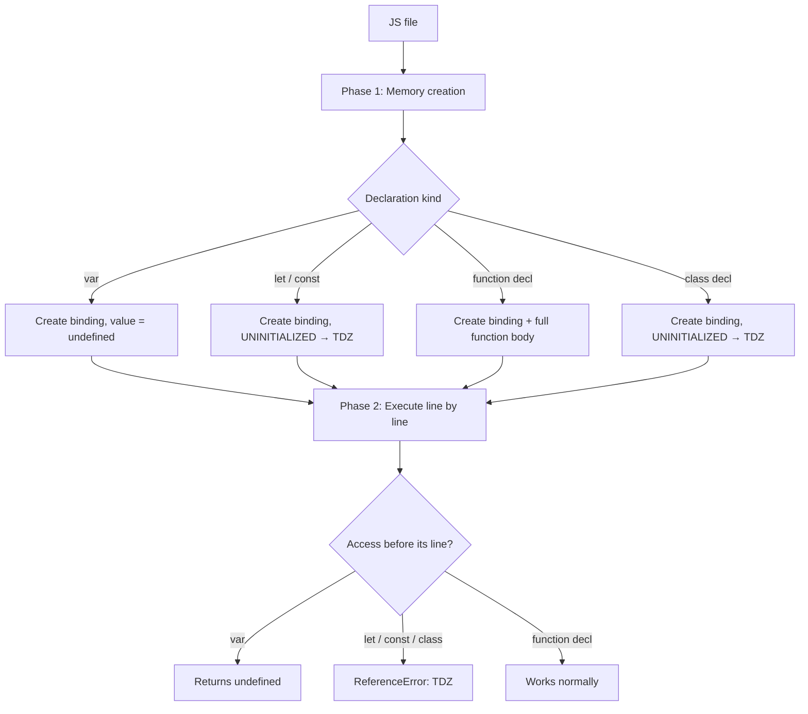

### 📊 TDZ behaviours worth memorising

| Code | Result | Reason |
|---|---|---|
| `console.log(x); var x = 1;` | `undefined` | var initialised to `undefined` |
| `console.log(x); let x = 1;` | `ReferenceError` | TDZ |
| `typeof undeclaredVar` | `"undefined"` | No binding at all |
| `typeof letVarInTDZ` | `ReferenceError` | Binding exists, uninitialized |
| `let x = x;` | `ReferenceError` | RHS evaluated while x is in TDZ |
| `const obj = {}; obj.a = 1;` | ✅ works | const protects the binding, not contents |
| `const obj = {}; Object.freeze(obj);` | Shallow freeze only | Nested objects still mutable |

### 🧪 Classic loop trap

```js
for (var i = 0; i < 3; i++) setTimeout(() => console.log("var:", i), 0);
// var: 3
// var: 3
// var: 3   ← one shared i

for (let j = 0; j < 3; j++) setTimeout(() => console.log("let:", j), 0);
// let: 0
// let: 1
// let: 2   ← fresh binding per iteration
```

### 🎯 Interview questions

| Question | Answer |
|---|---|
| What is hoisting? | Declarations are registered in memory before execution. Not literally "moved". |
| Difference between `undefined` and "not defined"? | `undefined` = binding exists, no value. "not defined" = `ReferenceError`, no binding at all. |
| Difference between "not defined" and "not initialized"? | "not initialized" = `let`/`const` binding exists but is in TDZ. |
| Can you call a function before it's declared? | Only function *declarations*; not expressions or arrow functions. |
| Are classes hoisted? | Yes, but they stay in the TDZ — you can't instantiate before the class line. |
| Why does `for (var i…)` print 3,3,3? | One function-scoped `i` shared by all callbacks. `let` creates a new binding per iteration. |
| Is `const` deep-immutable? | No. `Object.freeze()` is also shallow. |
| Why prefer `const` over `let`? | Signals intent, prevents accidental reassignment, and enables engine optimisations. |

### 💻 Coding problems

**P1.3** — What is the output?

```js
var x = 10;
function test() {
  console.log(x);
  var x = 20;
  console.log(x);
}
test();
console.log(x);
```
> `undefined`, `20`, `10` — the inner `var x` shadows the global.

**P1.4** — Fix this so it prints 0,1,2 *without* changing `setTimeout`:

```js
for (var i = 0; i < 3; i++) {
  setTimeout(() => console.log(i), 0);
}
```
```js
// Option A: use let
for (let i = 0; i < 3; i++) setTimeout(() => console.log(i), 0);

// Option B: IIFE
for (var i = 0; i < 3; i++) (function (j) {
  setTimeout(() => console.log(j), 0);
})(i);
```

**P1.5** — Make `config` truly immutable (including nested keys).

```js
function deepFreeze(obj) {
  Object.values(obj).forEach(v => {
    if (v && typeof v === "object") deepFreeze(v);
  });
  return Object.freeze(obj);
}
const config = deepFreeze({ browser: "chrome", nested: { retries: 3 } });
```

⚡ **TL;DR:** Use `const` by default, `let` when reassigning, never `var`. Before execution, declarations are hoisted; `let`/`const`/`class` sit in the TDZ until their line runs.

---

## 5. Literals, Data Types, `null`/`undefined`, Numbers

### 🟢 ELI5
A **literal** is a value typed out directly — `42`, `"hi"`, `true`, `[1,2]`, `{a:1}`. A **data type** is what *kind* of thing a value is. `null` is a sticky note saying "deliberately empty"; `undefined` means "nobody filled this in yet".

### 📊 The 8 JavaScript types

| Type | `typeof` result | Example | Mutable? | Notes |
|---|---|---|---|---|
| `string` | `"string"` | `"abc"`, `'abc'`, `` `abc` `` | ❌ Immutable | UTF-16 sequence |
| `number` | `"number"` | `42`, `3.14`, `NaN`, `Infinity` | ❌ | 64-bit float only |
| `bigint` | `"bigint"` | `9007199254740993n` | ❌ | For > 2^53 integers |
| `boolean` | `"boolean"` | `true`, `false` | ❌ | — |
| `undefined` | `"undefined"` | `undefined` | ❌ | Declared but not assigned |
| `null` | `"object"` (bug) | `null` | ❌ | Intentional empty |
| `symbol` | `"symbol"` | `Symbol("id")` | ❌ | Unique keys |
| `object` | `"object"` | `{}`, `[]`, `function(){}`, `Date` | ✅ | Reference type |

### 📊 Literal kinds

| Literal | Example | Notes |
|---|---|---|
| String | `"text"`, `'text'`, `` `text` `` | Backticks allow `${interpolation}` |
| Numeric | `10`, `3.14`, `0xFF`, `0b1010`, `1_000_000`, `1e3` | All become `number` |
| Boolean | `true`, `false` | — |
| Null | `null` | Explicitly "no value" |
| Array | `[1, 2, 3]` | Index 0-based |
| Object | `{ name: "Dev", age: 30 }` | Key/value pairs |
| Template | `` `Hi ${name}` `` | Multi-line + interpolation |
| Regex | `/ab+c/gi` | Pattern matching |

### 📊 `null` vs `undefined`

| Aspect | `null` | `undefined` |
|---|---|---|
| Meaning | Intentionally empty | Never assigned / absent |
| Who sets it | You, deliberately | JavaScript automatically |
| `typeof` | `"object"` (historic bug) | `"undefined"` |
| Loose `==` with each other | `null == undefined` → `true` | same |
| Strict `===` | `null === undefined` → `false` | false |
| Default function param | Not triggered | Triggers default |
| JSON | Serialised as `null` | Dropped from objects |
| Typical use | "No result" from an API | Uninitialised variable, missing property |

```js
let a;                 // undefined
let b = null;          // null
function f(x) { return x; }
f();                   // undefined
({}).missing;          // undefined
JSON.stringify({ a: undefined, b: null }); // '{"b":null}'
```

### 📊 Number gotchas

| Code | Result | Why |
|---|---|---|
| `0.1 + 0.2` | `0.30000000000000004` | Binary floating point |
| `0.1 + 0.2 === 0.3` | `false` | Same |
| `Number.isInteger(1.0)` | `true` | `1.0` is just `1` |
| `1 / 0` | `Infinity` | No divide-by-zero error |
| `0 / 0` | `NaN` | Not a Number |
| `NaN === NaN` | `false` | Use `Number.isNaN()` |
| `Number("12px")` | `NaN` | Partial parse fails |
| `parseInt("12px")` | `12` | Stops at first non-digit |
| `(0.1 + 0.2).toFixed(2)` | `"0.30"` | String rounding |
| `Number.MAX_SAFE_INTEGER` | `9007199254740991` | Beyond this, use `BigInt` |
| `"5" * "2"` | `10` | `*` coerces to number |
| `"5" + 2` | `"52"` | `+` prefers string concat |

### 🎯 Interview questions

| Question | Answer |
|---|---|
| Why is `typeof null === "object"`? | Legacy bug from the first JS engine; kept for backward compatibility. |
| `null == undefined`? `null === undefined`? | `true` and `false`. Loose equality treats them as equal. |
| How do you check for `NaN`? | `Number.isNaN(x)` — `x === NaN` is always false. |
| How do you compare floats? | `Math.abs(a - b) < Number.EPSILON` (or round to N decimals). |
| Difference between `Number("")` and `parseInt("")`? | `0` vs `NaN`. |
| Is a string primitive or object? | Primitive, but auto-boxed to `String` for method calls. |
| What does `typeof []` return? | `"object"` — use `Array.isArray()`. |
| How to check a real object (not null/array)? | `typeof v === "object" && v !== null && !Array.isArray(v)`. |

### 💻 Coding problems

**P1.6** — Safely sum two decimals so `0.1 + 0.2` compares equal to `0.3`.

```js
const isEqual = (a, b) => Math.abs(a - b) < Number.EPSILON;
console.log(isEqual(0.1 + 0.2, 0.3)); // true
```

**P1.7** — Write `typeOf(value)` that returns a precise type string.

```js
function typeOf(v) {
  if (v === null) return "null";
  if (Array.isArray(v)) return "array";
  return typeof v;
}
console.log(typeOf(null), typeOf([]), typeOf(1), typeOf("a"));
// null array number string
```

**P1.8** — Convert `"₹1,234.56"` to `1234.56`.

```js
const price = Number("₹1,234.56".replace(/[^\d.]/g, ""));
console.log(price); // 1234.56
```

⚡ **TL;DR:** `typeof null` is `"object"` (bug). Use `Number.isNaN`, `Array.isArray`, `===`. JS has one number type and it's floating point — never compare decimals with `===` directly.

---

## 6. Operators (All 12 Groups)

### 🟢 ELI5
Operators are **verbs for values**: `+` joins, `===` asks "identical?", `&&` says "and", `??` says "use the right side if the left is null/undefined", `++` means "add one".

### 📊 Operator groups

| Group | Operators | Example | Result |
|---|---|---|---|
| Assignment | `=`, `+=`, `-=`, `*=`, `/=`, `%=`, `**=` | `x += 2` | `x = x + 2` |
| Arithmetic | `+`, `-`, `*`, `/`, `%`, `**` | `7 % 3` | `1` |
| Comparison | `==`, `!=`, `===`, `!==`, `>`, `<`, `>=`, `<=` | `5 === "5"` | `false` |
| Logical | `&&`, `\|\|`, `!` | `true && false` | `false` |
| Nullish coalescing | `??` | `null ?? "default"` | `"default"` |
| Optional chaining | `?.` | `obj?.a?.b` | `undefined` if missing |
| Ternary | `cond ? a : b` | `age >= 18 ? "adult" : "minor"` | `"adult"` |
| Type | `typeof`, `instanceof` | `typeof 1` | `"number"` |
| Membership | `in`, `delete` | `"a" in obj` | `true` |
| Unary | `+x`, `-x`, `!x`, `~x` | `+"5"` | `5` |
| Increment/decrement | `++`, `--` (prefix/postfix) | `i++` | old value, then +1 |
| Bitwise | `&`, `\|`, `^`, `~`, `<<`, `>>`, `>>>` | `5 & 1` | `1` |

### 📊 `==` vs `===` (the #1 interview trap)

| Expression | `==` | `===` | Reason |
|---|---|---|---|
| `5 == "5"` | ✅ `true` | ❌ `false` | Loose coerces string → number |
| `0 == false` | ✅ `true` | ❌ `false` | `false` → `0` |
| `"" == 0` | ✅ `true` | ❌ `false` | `""` → `0` |
| `null == undefined` | ✅ `true` | ❌ `false` | Special-case rule |
| `null == 0` | ❌ `false` | ❌ `false` | `null` only equals `undefined` |
| `NaN == NaN` | ❌ `false` | ❌ `false` | NaN is never equal to itself |
| `"0" == false` | ✅ `true` | ❌ `false` | Both → `0` |
| `[] == false` | ✅ `true` | ❌ `false` | `[]` → `""` → `0` |
| `"" == "0"` | ❌ `false` | ❌ `false` | Both strings, compared as-is (breaks transitivity!) |

> Rule of thumb: **always use `===` / `!==`.** The only sane use of `==` is `x == null` to mean "null or undefined".

### 📊 Truthy vs falsy

| Falsy values (only 8) | Everything else is truthy |
|---|---|
| `false`, `0`, `-0`, `0n`, `""`, `null`, `undefined`, `NaN` | `"0"`, `" "`, `[]`, `{}`, `function(){}`, `-1` |

```js
if ("0") console.log("truthy");   // runs
if ([])  console.log("truthy");   // runs
if (0)   console.log("never");    // doesn't run
```

### 📊 `&&`, `||`, `??` — value-returning logic

| Operator | Returns | Fallback triggers on |
|---|---|---|
| `a \|\| b` | First truthy operand, else `b` | Any falsy (`0`, `""`, `false`) |
| `a && b` | First falsy operand, else `b` | Short-circuits on falsy |
| `a ?? b` | `a` unless it's `null`/`undefined` | Only `null` / `undefined` |

```js
const port = 0;
console.log(port || 8080);  // 8080  ← wrong if 0 is valid!
console.log(port ?? 8080);  // 0     ← correct
```

### 📊 `++i` vs `i++`

| Expression | `i` before | Value returned | `i` after |
|---|---|---|---|
| `i++` (postfix) | 5 | `5` | 6 |
| `++i` (prefix) | 5 | `6` | 6 |

```js
let i = 5;
console.log(i++, i);   // 5 6
console.log(++i, i);   // 7 7
```

### 🧪 Example

```js
let x = 10;
x += 5;             // 15
x **= 2;            // 225
console.log(x % 7); // 1

console.log(10 / 3);            // 3.3333333333333335
console.log(Math.floor(10 / 3)); // 3
console.log(2 ** 10);            // 1024

console.log(typeof []);            // "object"
console.log([] instanceof Array);  // true
console.log("name" in { name: 1 });// true

const user = { profile: { city: "Pune" } };
console.log(user?.profile?.city);  // "Pune"
console.log(user?.address?.city);  // undefined (no crash)
```

### 🔁 Evaluation flowchart for `==`

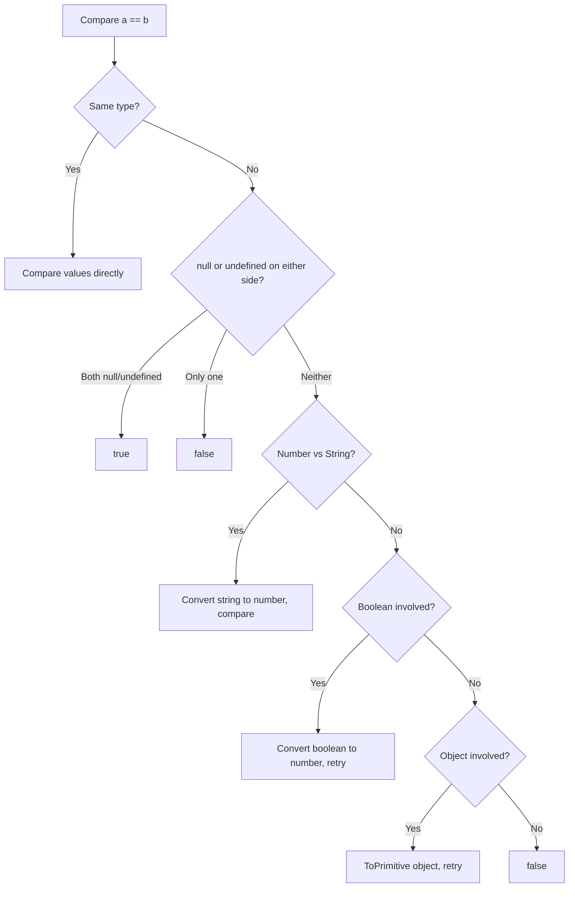

### 🎯 Interview questions

| Question | Answer |
|---|---|
| Why prefer `===`? | No coercion → predictable, fewer bugs. |
| `console.log(0.1 + 0.2 == 0.3)` | `false` — floating-point precision. |
| Difference between `\|\|` and `??`? | `\|\|` falls back on any falsy; `??` only on `null`/`undefined`. |
| What does `[] + []` produce? | `""` (both arrays → empty strings, concatenated). |
| What does `[] + {}` produce? | `"[object Object]"`. |
| What does `{} + []` produce? | `0` in expression position (block + empty array) — context-dependent. |
| What is optional chaining for? | Safe property access on `null`/`undefined` without throwing. |
| What does `delete` return? | `true` unless the property is non-configurable (strict mode throws). |
| Difference between `in` and `hasOwnProperty`? | `in` checks the prototype chain too; `hasOwnProperty` only own properties. |
| What is short-circuit evaluation? | `&&`/`\|\|` stop evaluating once the result is known. |

### 💻 Coding problems

**P1.9** — Predict the output.

```js
console.log("" == 0);        // true
console.log("" === 0);       // false
console.log(null == undefined); // true
console.log(null === undefined); // false
console.log("5" - 2);        // 3
console.log("5" + 2);        // "52"
console.log([] == false);    // true
console.log([1] == 1);       // true
```

**P1.10** — Implement a safe accessor without `?.`.

```js
function get(obj, path, fallback = undefined) {
  const keys = path.split(".");
  let cur = obj;
  for (const k of keys) {
    if (cur == null) return fallback;
    cur = cur[k];
  }
  return cur ?? fallback;
}
console.log(get({ a: { b: 1 } }, "a.b"));  // 1
console.log(get({}, "a.b", "n/a"));        // "n/a"
```

**P1.11** — Swap two variables without a temp variable.

```js
let a = 1, b = 2;
[a, b] = [b, a];
console.log(a, b); // 2 1
```

⚡ **TL;DR:** Use `===`. Remember the 8 falsy values. `??` is for "null-ish only", `?.` prevents crashes, and `+` with a string concatenates while `-` coerces to number.

---

# PART 2 — CONTROL FLOW & DATA

---

## 7. Statements and `if` / `else`

### 🟢 ELI5
`if` is a **fork in the road**: "if it's raining, take an umbrella; otherwise, wear sunglasses." `else if` adds more forks, `else` is the catch-all.

### 📊 Branching constructs

| Construct | Use when | Example |
|---|---|---|
| `if` | One condition | `if (age >= 18) allow();` |
| `if…else` | Two outcomes | `if (ok) pass(); else fail();` |
| `if…else if…else` | 3+ mutually exclusive cases | Grade calculation |
| `switch` | Many cases on one value | Status codes |
| Ternary `? :` | Short value choice | `const label = ok ? "PASS" : "FAIL";` |
| `&&` / `\|\|` | Short conditional execution | `isReady && start();` |

### 📊 `if` vs ternary vs `&&`

| Style | Best for | Readability |
|---|---|---|
| `if/else` | Multiple statements per branch | ✅ Best for logic |
| Ternary | Single value assignment | ✅ Best for 2 outcomes |
| `cond && fn()` | One side-effect statement | ⚠️ Fine, avoid nesting |
| `cond \|\| default` | Fallback value | ✅ But beware falsy `0`/`""` |

### 🧪 Walkthrough

```js
const score = 78;

if (score >= 90) {
  console.log("A");
} else if (score >= 75) {
  console.log("B");
} else if (score >= 60) {
  console.log("C");
} else {
  console.log("Fail");
}
// B
```

```js
// Guard clauses — flatter, easier to read than nested ifs
function login(user) {
  if (!user) return "no user";
  if (!user.active) return "inactive";
  if (!user.password) return "no password";
  return "ok";
}
```

### 🔁 Branch flowchart

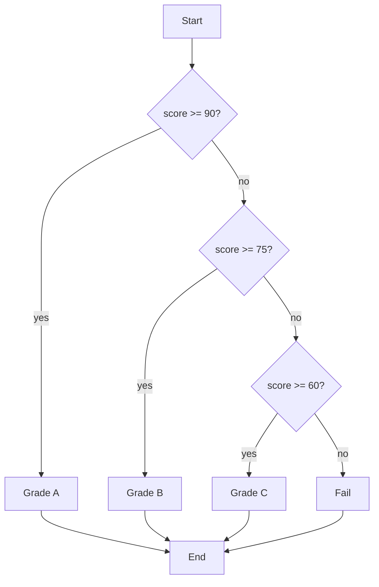

### 🎯 Interview questions

| Question | Answer |
|---|---|
| Difference between `if (x)` and `if (x === true)`? | `if (x)` checks truthiness (so `"0"`, `[]` pass); `=== true` requires the boolean `true`. |
| Can `else` exist without `if`? | No. `else if` is just `else` containing an `if`. |
| What does `if (0)` do? | Skips the block — `0` is falsy. |
| When should you use a guard clause? | At the top of a function to reject invalid input early (reduces nesting). |
| Is `if (a = b)` legal? | Yes — it assigns and tests `b`. Almost always a bug; linters catch it. |

### 💻 Coding problem
**P2.1** — Grade classifier with guard clauses and no nested `if`.

```js
function grade(score) {
  if (typeof score !== "number" || Number.isNaN(score)) return "invalid";
  if (score < 0 || score > 100) return "out of range";
  if (score >= 90) return "A";
  if (score >= 75) return "B";
  if (score >= 60) return "C";
  return "Fail";
}
```

---

## 8. `switch`

### 🟢 ELI5
`switch` is a **vending machine keypad**: press a value, and only the matching slot drops. `break` stops the machine from dispensing every slot below.

### 📊 `switch` vs `if/else`

| Aspect | `switch` | `if/else if` |
|---|---|---|
| Compares | One expression against `===` values | Any boolean expression |
| Readability | ✅ Great for many exact values | ✅ Great for ranges |
| Fall-through | Happens without `break` | N/A |
| Ranges | ❌ Not directly | ✅ `x > 10 && x < 20` |
| Default case | `default:` | `else` |
| Typical use | Status codes, browser names, commands | Validation, boundaries |

### 📊 Fall-through behaviour

| Case | Behaviour |
|---|---|
| `case "a": ... break;` | Runs only `"a"` |
| `case "a":` (no break, next `case "b"`) | Runs `"a"` **and** `"b"` |
| `case "a": case "b": ... break;` | Grouped — both share the body |
| `default:` anywhere | Runs if nothing matched (position doesn't matter) |

### 🧪 Walkthrough

```js
function statusLabel(code) {
  switch (code) {
    case 200:
      return "OK";
    case 201:
      return "Created";
    case 301:
    case 302:
      return "Redirect";        // grouped cases
    case 400:
    case 401:
    case 403:
      return "Client error";
    case 500:
      return "Server error";
    default:
      return `Unknown (${code})`;
  }
}

console.log(statusLabel(302)); // Redirect
console.log(statusLabel(404)); // Unknown (404)
```

```js
// Fall-through on purpose — accumulate
function daysInMonth(month) {
  switch (month) {
    case 2: return 28;
    case 4: case 6: case 9: case 11: return 30;
    default: return 31;
  }
}
```

### 🔁 Switch flowchart

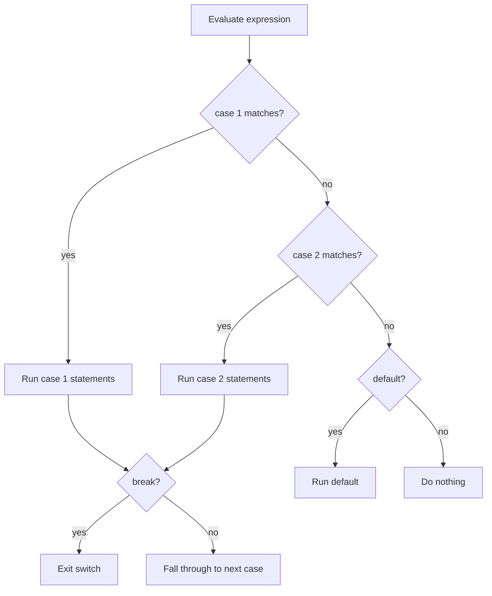

### 🎯 Interview questions

| Question | Answer |
|---|---|
| What happens without `break`? | Execution falls through into the next case. |
| Does `switch` use strict comparison? | Yes, `===` — so `"1"` won't match `case 1`. |
| Can `default` be first? | Yes; it still only runs if no case matches. |
| Can you use a range in `switch`? | Yes via `case x > 10` (a boolean expression) or `switch (true)`, but `if/else` is clearer. |
| Is `switch` faster than `if/else`? | Historically for many cases yes (jump table), but modern engines optimise both. Prefer readability. |
| Can you `return` from inside `switch` in a function? | Yes — no `break` needed when returning. |

### 💻 Coding problem
**P2.2** — Browser keyword → launch config, using grouped cases.

```js
function browserConfig(browser) {
  switch (browser.toLowerCase()) {
    case "chrome":
    case "edge":
      return { engine: "chromium", headless: true };
    case "firefox":
      return { engine: "firefox", headless: true };
    case "safari":
      return { engine: "webkit", headless: false };
    default:
      throw new Error(`Unsupported browser: ${browser}`);
  }
}
```

---

## 9. User Input (Node.js)

### 🟢 ELI5
Normally code runs alone. **Input** is how you hand it a note: "what's your name?" Browsers ask with `prompt()`; Node has no browser, so you use `readline`, environment variables, command-line arguments, or files.

### 📊 Input methods

| Method | Environment | Synchronous? | Best for |
|---|---|---|---|
| `prompt()` | Browser only | ✅ | Quick demos |
| `readline` (callback) | Node | ❌ async | Interactive CLI |
| `readline/promises` | Node 17+ | `await` | Modern CLI |
| `process.argv` | Node | ✅ | Script arguments |
| `process.env` | Node | ✅ | Secrets, CI config |
| `fs.readFileSync` | Node | ✅ | File-driven test data |
| `prompt-sync` package | Node | ✅ | Simple learning scripts |

### 🧪 Walkthrough — readline

```js
import readline from "node:readline/promises";
import { stdin as input, stdout as output } from "node:process";

const rl = readline.createInterface({ input, output });
const name = await rl.question("What is your name? ");
console.log(`Hello, ${name}!`);
rl.close();
```

### 🧪 Walkthrough — argv and env

```js
// node 51_Fs.js staging chrome
const env = process.argv[2] ?? "staging";
const browser = process.argv[3] ?? "chrome";
const apiKey = process.env.API_KEY ?? "missing";
console.log({ env, browser, apiKey });
```

```bash
API_KEY=secret node 51_Fs.js prod firefox
# { env: 'prod', browser: 'firefox', apiKey: 'secret' }
```

### 🧪 Walkthrough — file input

```js
import fs from "node:fs";

const data = JSON.parse(fs.readFileSync("./testdata.json", "utf8"));
data.users.forEach(u => console.log(u.email));
```

### 🔁 Input pipeline

```
 source of input                  process                    usage
┌──────────────────┐   ┌────────────────────────┐   ┌──────────────────┐
│ terminal / argv  │──▶│ readline / process.argv│──▶│ parsed variables │
│ env vars         │──▶│ process.env            │──▶│ config object    │
│ .json / .csv     │──▶│ fs.readFileSync        │──▶│ test data        │
└──────────────────┘   └────────────────────────┘   └──────────────────┘
```

### 🎯 Interview questions

| Question | Answer |
|---|---|
| Does Node have `prompt()`? | No — that's a browser API. Use `readline` or a package. |
| Difference between `argv[0]`, `[1]`, `[2]`? | `node` binary, script path, first user argument. |
| Is `process.env` always strings? | Yes — convert numbers with `Number(...)`. |
| Why prefer env vars for secrets? | They don't live in source control or logs. |
| `readFileSync` vs `readFile`? | Sync blocks the event loop; async doesn't. Use async in servers. |
| How do you read stdin line by line? | `readline.createInterface` and listen to `'line'` events. |

### 💻 Coding problem
**P2.3** — CLI calculator: `node calc.js add 2 3` → `5`.

```js
const [, , op, a, b] = process.argv;
const x = Number(a), y = Number(b);
const ops = {
  add: () => x + y,
  sub: () => x - y,
  mul: () => x * y,
  div: () => (y === 0 ? "division by zero" : x / y),
};
console.log((ops[op] ?? (() => "unknown op"))());
```

---

## 10. Loops

### 🟢 ELI5
A loop is a **chore list**: "for each dish, wash it." You need three things: where to start, when to stop, and what to do each round.

### 📊 Loop types

| Loop | Syntax | Best for | Break/continue |
|---|---|---|---|
| `for` | `for (init; cond; step)` | Known count | ✅ |
| `for…of` | `for (const v of iterable)` | Values of arrays, strings, Maps, Sets | ✅ |
| `for…in` | `for (const k in obj)` | **Keys** of objects | ✅ |
| `while` | `while (cond)` | Unknown count, check first | ✅ |
| `do…while` | `do { } while (cond)` | Must run **at least once** | ✅ |
| `forEach` | `arr.forEach(fn)` | Side effects per item | ❌ can't break |
| `map/filter/reduce` | `arr.map(fn)` | Transforming data | ❌ (but functional) |

### 📊 `for…of` vs `for…in`

| Aspect | `for…of` | `for…in` |
|---|---|---|
| Iterates | Values | Enumerable **keys** (strings) |
| Works on arrays | ✅ Values | ⚠️ Indexes, plus inherited props |
| Works on objects | ❌ (not iterable) | ✅ Keys |
| Prototype chain | Ignored | Included ⚠️ |
| Recommended for arrays | ✅ | ❌ |
| Recommended for objects | ❌ | ✅ (with `hasOwnProperty`) |

### 📊 `while` vs `do…while`

| Aspect | `while` | `do…while` |
|---|---|---|
| Condition checked | Before each iteration | After each iteration |
| Minimum runs | 0 | 1 |
| Use case | "while there is work" | "retry until success" (menu, API poll) |

### 🧪 Walkthrough

```js
// for — classic count
for (let i = 1; i <= 5; i++) console.log(i);

// for…of — array values
const browsers = ["chrome", "firefox", "webkit"];
for (const b of browsers) console.log(b);

// for…in — object keys
const config = { env: "staging", retries: 3 };
for (const key in config) {
  if (Object.hasOwn(config, key)) console.log(key, config[key]);
}

// while — unknown count
let attempts = 0;
while (attempts < 3) {
  attempts++;
  console.log(`attempt ${attempts}`);
}

// do…while — runs at least once
let n;
do {
  n = Math.floor(Math.random() * 10);
} while (n < 5);
console.log(n);
```

```js
// break / continue / labeled break
outer:
for (let i = 0; i < 3; i++) {
  for (let j = 0; j < 3; j++) {
    if (j === 2) continue;      // skip this j
    if (i === 2) break outer;   // exit both loops
    console.log(i, j);
  }
}
```

### 🔁 Loop flowchart

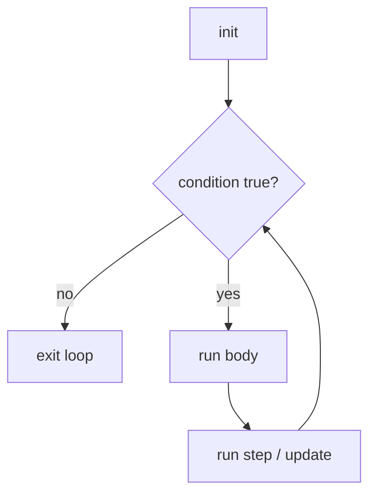

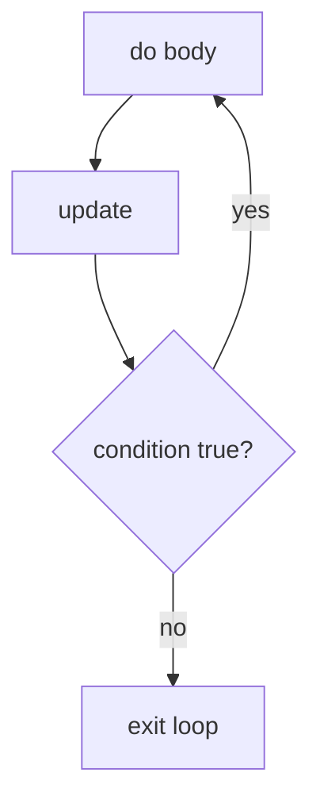

### 🎯 Interview questions

| Question | Answer |
|---|---|
| Which loop can't be broken? | `forEach` (no `break`/`continue`; throwing or `return` is the workaround). |
| When is `do…while` the right choice? | When the body must execute at least once (menus, retry-until-success). |
| `for…in` on an array — why bad? | Iterates inherited enumerable properties and returns strings, not values. |
| How do you break out of nested loops? | Labels (`outer:`) or a flag/`return`. |
| What is an infinite loop and how to avoid it? | Condition that never becomes false — ensure the step changes the condition variable. |
| `for` vs `forEach` performance? | Negligible; `for` supports `break`, `forEach` is more declarative. |
| How do you loop an object's entries? | `Object.entries(obj)` + `for…of`. |
| How do you iterate a Map? | `for (const [k, v] of map)`. |

### 💻 Coding problems

**P2.4** — FizzBuzz (1–100): multiples of 3 → Fizz, 5 → Buzz, both → FizzBuzz.

```js
for (let i = 1; i <= 100; i++) {
  let out = "";
  if (i % 3 === 0) out += "Fizz";
  if (i % 5 === 0) out += "Buzz";
  console.log(out || i);
}
```

**P2.5** — Sum only even numbers in an array.

```js
const sumEven = arr => arr.filter(n => n % 2 === 0).reduce((a, b) => a + b, 0);
console.log(sumEven([1, 2, 3, 4, 5, 6])); // 12
```

**P2.6** — Print a triangle of stars with nested loops.

```js
for (let i = 1; i <= 5; i++) console.log("*".repeat(i));
```

---

## 11. Arrays

### 🟢 ELI5
An array is a **numbered shelf**. Slot 0 is the first position. You can add books at the end (`push`), remove them (`pop`), and walk the shelf (`for…of`).

### 📊 Core array properties & methods

| Method / prop | Does | Mutates? | Returns |
|---|---|---|---|
| `length` | Count of items | — | `number` |
| `push(x)` | Add at end | ✅ | New length |
| `pop()` | Remove last | ✅ | Removed item |
| `unshift(x)` | Add at start | ✅ | New length |
| `shift()` | Remove first | ✅ | Removed item |
| `at(i)` | Item at index (supports negative) | ❌ | value |
| `indexOf(x)` | First index or `-1` | ❌ | number |
| `lastIndexOf(x)` | Last index or `-1` | ❌ | number |
| `includes(x)` | Exists? (uses SameValueZero) | ❌ | boolean |
| `find(fn)` | First matching value | ❌ | value / `undefined` |
| `findIndex(fn)` | Index of first match | ❌ | number / `-1` |
| `slice(a, b)` | Copy of part (end exclusive) | ❌ | new array |
| `splice(i, n, …items)` | Remove/insert in place | ✅ | removed items |
| `concat(a, b)` | Join arrays | ❌ | new array |
| `join(sep)` | To string | ❌ | string |
| `reverse()` | Reverse in place | ✅ | same array |
| `sort(fn)` | Sort in place | ✅ | same array |
| `flat(depth)` | Flatten nested arrays | ❌ | new array |
| `flatMap(fn)` | `map` + `flat(1)` | ❌ | new array |
| `fill(v, a, b)` | Fill slots | ✅ | same array |
| `some(fn)` | Any match? | ❌ | boolean |
| `every(fn)` | All match? | ❌ | boolean |
| `map(fn)` | Transform each | ❌ | new array |
| `filter(fn)` | Keep matching | ❌ | new array |
| `reduce(fn, init)` | Fold to one value | ❌ | any |
| `Array.isArray(x)` | Real array? | ❌ | boolean |
| `Array.from(iterable)` | Convert iterable | ❌ | new array |
| `Array.of(a, b)` | Build from args | ❌ | new array |

### 📊 Searching methods side by side

| Method | Returns | Not found | Use when |
|---|---|---|---|
| `indexOf(x)` | index | `-1` | Primitive lookup |
| `includes(x)` | `true/false` | `false` | Existence check |
| `find(fn)` | element | `undefined` | Object search by predicate |
| `findIndex(fn)` | index | `-1` | Need the position |
| `filter(fn)` | array | `[]` | All matches |
| `some(fn)` | boolean | `false` | At least one |
| `every(fn)` | boolean | `true` (vacuously) | All must pass |

### 📊 Shallow vs deep copy

| Operation | Depth | Nested objects shared? |
|---|---|---|
| `arr.slice()` | Shallow | ✅ shared |
| `[...arr]` | Shallow | ✅ shared |
| `Array.from(arr)` | Shallow | ✅ shared |
| `structuredClone(arr)` | Deep | ❌ copied |
| `JSON.parse(JSON.stringify(arr))` | Deep | ❌ copied (loses `Date`, `undefined`, functions) |

### 🧪 Walkthrough

```js
const tests = ["login", "signup", "search"];

tests.push("checkout");          // ["login","signup","search","checkout"]
tests.unshift("smoke");          // ["smoke","login","signup","search","checkout"]
tests.splice(2, 1);              // removes "signup"

console.log(tests.indexOf("search"));  // 2
console.log(tests.includes("login"));  // true
console.log(tests.slice(1, 3));        // ["login","search"]

const results = [
  { name: "login",  status: "pass" },
  { name: "signup", status: "fail" },
  { name: "search", status: "pass" },
];

const failed = results.filter(r => r.status === "fail").map(r => r.name);
console.log(failed); // ["signup"]

const passedCount = results.reduce((n, r) => n + (r.status === "pass"), 0);
console.log(passedCount); // 2
```

```js
// Destructuring + rest
const [first, second, ...rest] = [1, 2, 3, 4, 5];
console.log(first, second, rest); // 1 2 [3,4,5]

const [a = 10] = [];
console.log(a); // 10

// Sorting traps
console.log([10, 9, 100].sort());            // [10, 100, 9]  ← string sort!
console.log([10, 9, 100].sort((x, y) => x - y)); // [9, 10, 100]
```

### 🔁 `reduce` pipeline

```
[1, 2, 3, 4].reduce((acc, cur) => acc + cur, 0)

  acc=0  cur=1  → 1
  acc=1  cur=2  → 3
  acc=3  cur=3  → 6
  acc=6  cur=4  → 10   ✅
```

### 🎯 Interview questions

| Question | Answer |
|---|---|
| `slice` vs `splice`? | `slice` returns a copy and doesn't mutate; `splice` mutates the original and returns removed items. |
| How do you check for an array? | `Array.isArray(x)` (not `typeof`, which gives `"object"`). |
| Does `sort()` work on numbers? | Not by default — it converts to strings. Pass `(a,b)=>a-b`. |
| `map` vs `forEach`? | `map` returns a new array; `forEach` returns `undefined`. |
| `filter` vs `find`? | `filter` returns all matches; `find` returns the first. |
| How do you remove duplicates? | `[...new Set(arr)]`. |
| How do you copy an array? | `[...arr]` or `arr.slice()` (shallow). |
| What does `reduce` do with no initial value? | Uses the first element as the accumulator (throws on empty array). |
| How do you flatten `[1,[2,[3]]]`? | `arr.flat(Infinity)`. |
| Is `for…of` faster than `forEach`? | Comparable; `for…of` supports `break`/`await`. |
| How do you empty an array? | `arr.length = 0` or `arr.splice(0)`. |
| How do you compare two arrays? | Element-wise (`a.length === b.length && a.every((v,i)=>v===b[i])`) or `JSON.stringify`. |

### 💻 Coding problems

**P2.7** — Second largest number.

```js
function secondLargest(nums) {
  const uniq = [...new Set(nums)].sort((a, b) => b - a);
  return uniq.length > 1 ? uniq[1] : null;
}
console.log(secondLargest([5, 1, 9, 9, 3])); // 5
```

**P2.8** — Group tests by status.

```js
const results = [
  { name: "login", status: "pass" },
  { name: "signup", status: "fail" },
  { name: "search", status: "pass" },
];
const grouped = results.reduce((acc, r) => {
  (acc[r.status] ??= []).push(r.name);
  return acc;
}, {});
console.log(grouped); // { pass: ["login","search"], fail: ["signup"] }
```

**P2.9** — Rotate an array right by `k`.

```js
function rotateRight(arr, k) {
  const n = arr.length;
  if (!n) return arr;
  k %= n;
  return [...arr.slice(n - k), ...arr.slice(0, n - k)];
}
console.log(rotateRight([1, 2, 3, 4, 5], 2)); // [4,5,1,2,3]
```

---

## 12. Multi-Dimensional Arrays & Patterns

### 🟢 ELI5
A 2-D array is a **grid or spreadsheet**: rows and columns. `grid[row][col]`. Patterns (triangles, pyramids) are just nested loops deciding *how many* stars per row.

### 📊 Access & traversal

| Task | Code |
|---|---|
| Create 3×3 grid | `Array.from({length:3}, () => Array(3).fill(0))` |
| Read cell | `grid[r][c]` |
| Row count | `grid.length` |
| Column count (row 0) | `grid[0].length` |
| Most rows | `Math.max(...grid.map(r => r.length))` |
| Loop all cells | nested `for` |
| Flatten | `grid.flat()` |

### 🧪 Walkthrough

```js
const grid = [
  [1, 2, 3],
  [4, 5, 6],
  [7, 8, 9],
];

// Row-major traversal
for (let r = 0; r < grid.length; r++) {
  for (let c = 0; c < grid[r].length; c++) {
    process.stdout.write(`${grid[r][c]} `);
  }
  console.log();
}

// Column-wise traversal
for (let c = 0; c < grid[0].length; c++) {
  for (let r = 0; r < grid.length; r++) {
    process.stdout.write(`${grid[r][c]} `);
  }
  console.log();
}

// Sum
const total = grid.flat().reduce((a, b) => a + b, 0); // 45
```

### 🔁 Pattern formulas

| Pattern | Loop shape | Example output (n=4) |
|---|---|---|
| Right triangle | `for r in 1..n: print "*" * r` | `*`<br>`**`<br>`***`<br>`****` |
| Inverted right | `for r in n..1: print "*" * r` | `****`<br>`***`<br>`**`<br>`*` |
| Left-aligned mirrored | spaces `n-r`, then `*` × r | `   *`<br>`  **`<br>` ***`<br>`****` |
| Pyramid | spaces `n-r`, stars `2r-1` | `   *`<br>`  ***`<br>` *****`<br>`*******` |
| Number pyramid | same as pyramid, print `r` | `   1`<br>`  222`<br>` 33333` |

```js
const n = 4;

// pyramid
for (let r = 1; r <= n; r++) {
  console.log(" ".repeat(n - r) + "*".repeat(2 * r - 1));
}

// number pyramid
for (let r = 1; r <= n; r++) {
  console.log(" ".repeat(n - r) + String(r).repeat(2 * r - 1));
}

// multiplication table
for (let r = 1; r <= 3; r++) {
  let line = "";
  for (let c = 1; c <= 3; c++) line += `${r * c}\t`;
  console.log(line);
}
```

### 🔁 Grid traversal diagram

```
        c=0   c=1   c=2
      ┌─────┬─────┬─────┐
 r=0  │  1  │  2  │  3  │
      ├─────┼─────┼─────┤
 r=1  │  4  │  5  │  6  │
      ├─────┼─────┼─────┤
 r=2  │  7  │  8  │  9  │
      └─────┴─────┴─────┘

Row-major:    (0,0) → (0,1) → (0,2) → (1,0) → …
Column-major: (0,0) → (1,0) → (2,0) → (0,1) → …
```

### 🎯 Interview questions

| Question | Answer |
|---|---|
| How do you declare a 3×3 zero matrix? | `Array.from({length:3}, () => Array(3).fill(0))`. |
| Why is `Array(3).fill([])` dangerous? | All rows share the **same** array reference. |
| How do you traverse column-wise? | Outer loop over columns, inner loop over rows. |
| How do you transpose a matrix? | `grid[0].map((_, c) => grid.map(row => row[c]))`. |
| Space for a pyramid row `r`? | `n - r` spaces, then `2r - 1` stars. |
| How do you sum a 2-D array? | `grid.flat().reduce((a,b)=>a+b,0)` or nested loops. |

### 💻 Coding problems

**P2.10** — Transpose a matrix.

```js
const transpose = m => m[0].map((_, c) => m.map(row => row[c]));
console.log(transpose([[1,2,3],[4,5,6]])); // [[1,4],[2,5],[3,6]]
```

**P2.11** — Print a hollow square of size n.

```js
function hollowSquare(n) {
  for (let r = 0; r < n; r++) {
    let line = "";
    for (let c = 0; c < n; c++) {
      line += (r === 0 || r === n - 1 || c === 0 || c === n - 1) ? "* " : "  ";
    }
    console.log(line.trimEnd());
  }
}
hollowSquare(5);
```

---

## 13. Strings

### 🟢 ELI5
A string is a **beaded necklace**: each bead is a character, and the necklace itself never changes — any "change" gives you a brand-new necklace.

### 📊 String properties & methods

| Method / prop | Does | Example |
|---|---|---|
| `length` | Character count | `"abc".length` → `3` |
| `[i]` / `at(i)` | Character (negative ok with `at`) | `"abc".at(-1)` → `"c"` |
| `toUpperCase()` / `toLowerCase()` | Case change | `"Hi".toUpperCase()` |
| `trim()` / `trimStart()` / `trimEnd()` | Strip whitespace | `"  x ".trim()` |
| `includes(s)` | Substring exists? | `"hello".includes("ell")` |
| `startsWith(s)` / `endsWith(s)` | Prefix / suffix test | `"test.spec.ts".endsWith(".ts")` |
| `indexOf(s)` / `lastIndexOf(s)` | Position | `"a-b-a".indexOf("a")` → `0` |
| `slice(a, b)` | Substring (negative ok) | `"hello".slice(-3)` → `"llo"` |
| `substring(a, b)` | Like slice, no negatives | `"hello".substring(1,3)` → `"el"` |
| `split(sep)` | String → array | `"a,b".split(",")` → `["a","b"]` |
| `replace(a, b)` | First replacement | `"a-a".replace("a","x")` → `"x-a"` |
| `replaceAll(a, b)` | All replacements | `"a-a".replaceAll("a","x")` |
| `repeat(n)` | Repeat | `"ab".repeat(2)` → `"abab"` |
| `padStart(n, ch)` / `padEnd` | Pad | `"5".padStart(3,"0")` → `"005"` |
| `charAt(i)` / `charCodeAt(i)` | Char / code unit | `"A".charCodeAt(0)` → `65` |
| `concat(s)` | Join | `"a".concat("b")` |
| `match(re)` / `matchAll(re)` | Regex matches | `"a1b2".match(/\d/g)` |
| `search(re)` | Index of regex match | `"a1".search(/\d/)` → `1` |

### 📊 `slice` vs `substring` vs `substr`

| Aspect | `slice(start, end)` | `substring(start, end)` | `substr(start, length)` |
|---|---|---|---|
| Negative start | Counts from end | Treated as `0` | Counts from end |
| Swaps if start > end | ❌ returns `""` | ✅ swaps | ❌ |
| Second param | End index | End index | Length |
| Recommended | ✅ | ⚠️ | ❌ deprecated |

### 📊 Conversion

| Direction | Code |
|---|---|
| Number → string | `String(n)`, `n.toString()`, `` `${n}` ``, `n + ""` |
| String → number | `Number(s)`, `parseInt(s, 10)`, `parseFloat(s)`, `+s` |
| Array → string | `arr.join(",")` |
| String → array | `[...str]`, `str.split("")` |
| Object → string | `JSON.stringify(obj)` |
| String → object | `JSON.parse(json)` |

### 🧪 Walkthrough

```js
const raw = "  Login_Test_001  ";
const id = raw.trim();                       // "Login_Test_001"
const parts = id.split("_");                 // ["Login","Test","001"]
console.log(parts[2].padStart(5, "0"));      // "00001"

const email = "qa@example.com";
console.log(email.includes("@"), email.split("@")[1]); // true example.com

const sentence = "the quick brown fox";
console.log(sentence.replace("quick", "slow"));
console.log(sentence.split(" ").map(w => w[0].toUpperCase() + w.slice(1)).join(" "));
// "The Quick Brown Fox"

console.log("abc".at(-1));       // "c"
console.log("5".padStart(3, "0")); // "005"
console.log("A".charCodeAt(0));  // 65
```

### 🔁 Template literal flow

```
 `Hello ${name}, you have ${count} tests`
        │            │
        └─ variable ─┴─ expression ──▶ interpolated string
```

### 🎯 Interview questions

| Question | Answer |
|---|---|
| Are strings mutable? | No — all methods return new strings. |
| `slice` vs `substring`? | `slice` supports negatives; `substring` swaps reversed indices and clamps negatives to 0. |
| How do you reverse a string? | `[...str].reverse().join("")`. |
| How do you check a palindrome? | Compare `s` with its reverse, ignoring case/non-alphanumerics. |
| How do you count occurrences of a char? | `[...str].filter(c => c === target).length` or `str.split(target).length - 1`. |
| Is `str[0] = "x"` allowed? | No — silently fails (or throws in strict mode). |
| Difference between `==` and `===` for strings? | `==` coerces; `===` requires both to be strings. |
| `replace` vs `replaceAll`? | `replace` changes the first match unless the regex has `g`; `replaceAll` changes all. |
| `typeof` vs `instanceof` for strings? | `typeof s === "string"` works for primitives; `new String()` is an object — avoid it. |

### 💻 Coding problems

**P2.12** — Capitalise each word.

```js
const titleCase = s => s.toLowerCase().replace(/\b\w/g, c => c.toUpperCase());
console.log(titleCase("hello world from qa")); // "Hello World From Qa"
```

**P2.13** — Count vowels.

```js
const countVowels = s => (s.match(/[aeiou]/gi) || []).length;
console.log(countVowels("Playwright")); // 2
```

**P2.14** — Check anagram.

```js
const norm = s => s.toLowerCase().split("").sort().join("");
const isAnagram = (a, b) => norm(a) === norm(b);
console.log(isAnagram("Listen", "Silent")); // true
```

---

## 14. Objects

### 🟢 ELI5
An object is a **labeled drawer unit**: each drawer has a name (key) and holds a value. Methods are drawers that do work when you open them.

### 📊 Object syntax & operations

| Operation | Code |
|---|---|
| Create | `const o = { name: "Dev", age: 30 };` |
| Read | `o.name` or `o["name"]` |
| Add / update | `o.city = "Pune";` |
| Delete | `delete o.city;` |
| Check key | `"name" in o`, `Object.hasOwn(o, "name")` |
| Keys / values / entries | `Object.keys(o)`, `Object.values(o)`, `Object.entries(o)` |
| Copy (shallow) | `{ ...o }`, `Object.assign({}, o)` |
| Merge | `{ ...a, ...b }` |
| Freeze | `Object.freeze(o)` |
| Seal (no add/delete) | `Object.seal(o)` |
| Convert to JSON | `JSON.stringify(o)` |
| Iterate | `for (const [k, v] of Object.entries(o))` |

### 📊 Dot vs bracket notation

| Notation | Use when | Example |
|---|---|---|
| `obj.key` | Key is a fixed identifier | `user.name` |
| `obj["key"]` | Key is dynamic / has spaces | `obj[field]`, `obj["first name"]` |
| `obj?.key` | Object might be null | `user?.name` |

### 📊 Pass by value vs pass by reference

| Type | Passed as | Effect |
|---|---|---|
| Primitives | Copy of value | Reassign inside function → no change outside |
| Objects / arrays | Copy of reference | Mutating properties → visible outside |
| Reassigning object param | Local only | `param = {}` doesn't affect caller |

```js
function mutate(o) { o.a = 99; }
function reassign(o) { o = { a: 99 }; }
const obj = { a: 1 };
mutate(obj);    console.log(obj.a); // 99
reassign(obj);  console.log(obj.a); // 99 (still)
```

### 🧪 Walkthrough

```js
const user = {
  name: "Shashi",
  role: "QA",
  address: { city: "Pune", zip: "411001" },
  greet() { return `Hi, ${this.name}`; },
};

console.log(user.greet());            // "Hi, Shashi"
console.log(user.address?.city);      // "Pune"
console.log(Object.keys(user));       // ["name","role","address","greet"]

// Destructuring with defaults and rename
const { name, role: job = "Dev", ...rest } = user;
console.log(name, job, Object.keys(rest)); // Shashi QA ["address","greet"]

// Shallow copy shares nested objects
const copy = { ...user };
copy.address.city = "Mumbai";
console.log(user.address.city);       // "Mumbai"  ← shared!
```

```js
// Deep copy
const deep = structuredClone(user);
deep.address.city = "Delhi";
console.log(user.address.city);       // "Mumbai" (unchanged)
```

### 🔁 Object lifecycle

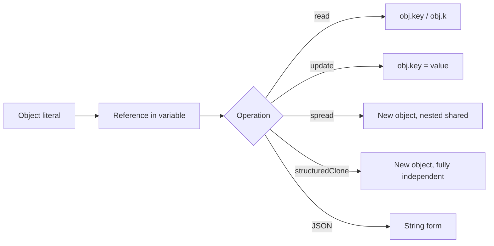

### 🎯 Interview questions

| Question | Answer |
|---|---|
| What is `this` inside an object method? | The object the method was called on (depends on call site). |
| Shallow vs deep copy? | Shallow copies the top level only; nested objects stay shared. |
| How do you deep copy? | `structuredClone(obj)` (modern) or `JSON.parse(JSON.stringify(obj))` (lossy). |
| How do you check an empty object? | `Object.keys(o).length === 0`. |
| Difference between `in` and `Object.hasOwn`? | `in` includes inherited props; `hasOwn` only own. |
| `Object.freeze` vs `Object.seal`? | Freeze blocks all changes; seal allows changing values but not adding/removing keys. |
| Why is `const` not enough for immutability? | `const` protects the binding, not the object's contents. |
| What does `JSON.stringify` drop? | `undefined`, functions, symbols; converts `Date` to ISO string; throws on cycles. |
| How do you merge two objects deeply? | `structuredClone` + recursive merge, or a library. |
| What is optional chaining on objects? | `obj?.a?.b` — stops and returns `undefined` at the first nullish link. |

### 💻 Coding problems

**P2.15** — Count occurrences of array elements using an object.

```js
const freq = arr => arr.reduce((m, x) => (m[x] = (m[x] || 0) + 1, m), {});
console.log(freq(["a","b","a","c","a"])); // { a: 3, b: 1, c: 1 }
```

**P2.16** — Deep merge two objects.

```js
function deepMerge(a, b) {
  const out = { ...a };
  for (const [k, v] of Object.entries(b)) {
    out[k] = v && typeof v === "object" && !Array.isArray(v)
      ? deepMerge(a[k] ?? {}, v)
      : v;
  }
  return out;
}
console.log(deepMerge({ a: { x: 1 } }, { a: { y: 2 } })); // { a: { x: 1, y: 2 } }
```

**P2.17** — Convert an object to query string.

```js
const qs = obj =>
  Object.entries(obj)
    .map(([k, v]) => `${encodeURIComponent(k)}=${encodeURIComponent(v)}`)
    .join("&");
console.log(qs({ env: "staging", retries: 3 })); // env=staging&retries=3
```

⚡ **TL;DR (Part 2):** `if/else` for ranges, `switch` for exact values. `for…of` for arrays, `for…in` for object keys. Arrays are 0-based and `sort()` is lexicographic by default. `slice` copies, `splice` mutates. Strings are immutable. Objects are reference types — spread copies are shallow.

---

# PART 3 — FUNCTIONS & ASYNC

---

## 15. Functions

### 🟢 ELI5
A function is a **recipe**: give it ingredients (parameters), it follows steps, and hands back a dish (return value). Write it once, cook it many times.

### 📊 Function forms

| Form | Syntax | Hoisted | `this` | Best for |
|---|---|---|---|---|
| Declaration | `function add(a,b){}` | ✅ Fully | Dynamic | Reusable utilities |
| Expression | `const add = function(a,b){}` | ❌ (var name only) | Dynamic | Assigning functions |
| Arrow | `const add = (a,b) => a+b` | ❌ | Lexical (from outer) | Callbacks, short helpers |
| Method | `{ add(a,b){} }` | N/A | Owning object | Object behaviour |
| Constructor | `function User(){}` + `new` | ✅ | New instance | Legacy OOP |
| IIFE | `(function(){})()` | N/A | — | Private scope |
| Generator | `function* gen(){}` | ✅ | — | Lazy sequences |
| Async | `async function f(){}` | ✅ | — | Promise-returning work |

### 📊 Parameters

| Feature | Syntax | Notes |
|---|---|---|
| Default | `function f(a = 1)` | Used when arg is `undefined` (not `null`) |
| Rest | `function f(...nums)` | Collects extras into a real array |
| Destructured | `function f({ name, age })` | Great for config objects |
| Spread at call | `f(...arr)` | Expands an array into args |
| `arguments` | `arguments[0]` | Array-like; unavailable in arrows |
| Optional call | `fn?.()` | Calls only if `fn` is defined |

### 📊 `return` behaviour

| Situation | Result |
|---|---|
| No `return` | `undefined` |
| `return;` | `undefined` |
| `return value;` | That value |
| Multiple values | Return an object/array: `return { a, b }` |
| Arrow with `{}` | Must write `return` explicitly |
| Arrow without `{}` | Implicit return |

### 🧪 Walkthrough

```js
// declaration
function add(a, b) { return a + b; }

// expression
const sub = function (a, b) { return a - b; };

// arrow — implicit return
const mul = (a, b) => a * b;

// arrow returning an object needs parentheses
const makeUser = (name) => ({ name, active: true });

// default + rest
function log(level = "info", ...messages) {
  console.log(`[${level}]`, ...messages);
}
log();                       // [info]
log("warn", "slow", "test"); // [warn] slow test

// destructured config
function connect({ host = "localhost", port = 5432 } = {}) {
  return `${host}:${port}`;
}
connect();                   // localhost:5432
connect({ port: 8080 });     // localhost:8080

// higher-order function
const apply = (fn, value) => fn(value);
console.log(apply(x => x * 2, 5)); // 10
```

### 🔁 Call → execution flow

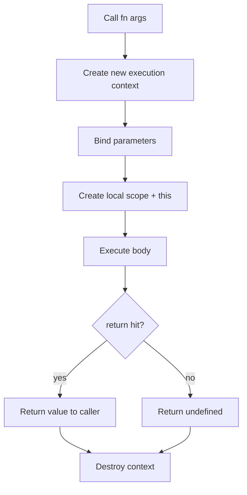

### 🎯 Interview questions

| Question | Answer |
|---|---|
| Function declaration vs expression? | Declarations are fully hoisted; expressions are not. |
| Arrow vs normal function? | Arrow has no own `this`, no `arguments`, cannot be `new`ed; normal functions have dynamic `this`. |
| Can you return multiple values? | Only one value — wrap in an array or object. |
| What is a higher-order function? | A function that takes or returns another function (`map`, `filter`, custom wrappers). |
| What is a pure function? | Same input → same output, no side effects. |
| What is a side effect? | Changing state outside the function (I/O, globals, mutation). |
| What is recursion? | A function calling itself; needs a base case. |
| What happens if you omit `return` in an arrow with braces? | You get `undefined`. |
| Are JS functions first-class? | Yes — assignable, passable, returnable. |
| What is `arguments`? | Array-like object of all args; not in arrows (use rest params). |
| How do you set `this` explicitly? | `call`, `apply`, `bind` (or arrow functions capture lexical `this`). |
| What is a closure? | A function plus the scope it captured (see §16). |

### 💻 Coding problems

**P3.1** — `repeat(fn, n)` that calls `fn` n times and returns the results.

```js
const repeat = (fn, n) => Array.from({ length: n }, (_, i) => fn(i));
console.log(repeat(i => i * 2, 4)); // [0,2,4,6]
```

**P3.2** — Memoize an expensive function.

```js
function memoize(fn) {
  const cache = new Map();
  return function (arg) {
    if (cache.has(arg)) return cache.get(arg);
    const result = fn(arg);
    cache.set(arg, result);
    return result;
  };
}
const slowSquare = n => { for (let i = 0; i < 1e6; i++); return n * n; };
const fastSquare = memoize(slowSquare);
console.log(fastSquare(9), fastSquare(9)); // 81 81 (second is cached)
```

**P3.3** — Curry a 3-argument function.

```js
const curry = fn => a => b => c => fn(a, b, c);
const volume = curry((l, w, h) => l * w * h);
console.log(volume(2)(3)(4)); // 24
```

---

## 16. Scope and Closures

### 🟢 ELI5
**Scope** is which rooms can see a box. **Closure** is a backpack: when a function leaves its home room, it packs the variables it needs and keeps them — even after the room is gone.

### 📊 Scope types

| Scope | Created by | Visible where |
|---|---|---|
| Global | Top level of file/script | Everywhere |
| Module | Each ES module file | Only that file (unless exported) |
| Function | Each function call | Inside that function + nested |
| Block | `{ }`, `if`, `for`, `try` | Inside that block (with `let`/`const`) |
| Lexical | Physical nesting of code | Inner sees outer |

### 📊 Scope chain lookup

| Step | Rule |
|---|---|
| 1 | Look in local scope |
| 2 | Look in enclosing function scope |
| 3 | Continue outward through each parent |
| 4 | Look in module scope |
| 5 | Look in global scope |
| 6 | Throw `ReferenceError` if still not found |

### 🧪 Closure walkthrough

```js
function makeCounter() {
  let count = 0;                // captured by the inner function
  return function () {
    count += 1;
    return count;
  };
}

const next = makeCounter();
console.log(next()); // 1
console.log(next()); // 2
console.log(next()); // 3
// makeCounter's scope would normally be gone — the closure keeps it alive.
```

```js
// Real use: per-test state
function createTestContext(name) {
  let attempts = 0;
  return {
    name,
    attempt() { return ++attempts; },
    reset() { attempts = 0; },
  };
}

const login = createTestContext("login");
console.log(login.attempt(), login.attempt()); // 1 2
login.reset();
console.log(login.attempt()); // 1
```

### 🔁 Closure memory diagram

```
makeCounter() call #1
┌──────────────────────────────┐
│ Local env: count = 0         │
│   ▲                          │
│   │ captured                 │
│ returns ──▶ function() {     │
│               count += 1     │
│             }                │
└──────────────────────────────┘
        ▲
        │ next() still holds a reference,
        │ so the env is NOT garbage-collected
```

### 📊 Common closure traps

| Code | Output | Why |
|---|---|---|
| `for (var i…) setTimeout(()=>log(i))` | `3,3,3` | One shared `i` |
| `for (let i…) setTimeout(()=>log(i))` | `0,1,2` | Per-iteration binding |
| Method passed as callback | `this` lost | `this` depends on call site |
| `var` inside `if` | Leaks out | `var` is function-scoped |

### 🎯 Interview questions

| Question | Answer |
|---|---|
| What is a closure? | A function bundled with the lexical environment it was created in. |
| Why are closures useful? | Data privacy, stateful functions, factories, memoisation, partial application. |
| Do closures cause memory leaks? | They can, if they retain large objects past their useful life. |
| What is the module pattern? | An IIFE returning an object with closures over private state. |
| Difference between scope and context? | Scope = variable visibility; context = the value of `this`. |
| What is lexical scoping? | Scope determined by where code is written, not where it's called. |
| How do you create a private variable? | Declare it in a closure (or use `#field` in a class). |
| What is a IIFE's purpose? | Run code immediately in its own private scope. |
| Why does a closure see the latest value of a `var`? | It captures the *binding*, not the value at creation time. |
| How do you fix the loop closure bug? | Use `let`, an IIFE, or `forEach`'s own parameter. |

### 💻 Coding problems

**P3.4** — `once(fn)` — runs only the first time.

```js
function once(fn) {
  let called = false;
  let result;
  return (...args) => {
    if (!called) { called = true; result = fn(...args); }
    return result;
  };
}
const init = once(() => { console.log("init"); return 42; });
console.log(init(), init()); // "init" then 42 42
```

**P3.5** — Build an adder factory.

```js
const addTo = a => b => a + b;
console.log(addTo(5)(3)); // 8
```

**P3.6** — Private counter without classes.

```js
function counter() {
  let n = 0;
  return { inc: () => ++n, get: () => n };
}
const c = counter();
c.inc(); c.inc();
console.log(c.get()); // 2
```

---

## 17. Callbacks

### 🟢 ELI5
A callback is a **phone number you leave**: "when the food is ready, call me." You hand a function to another function, and it runs it later.

### 📊 Sync vs async callbacks

| Aspect | Sync callback | Async callback |
|---|---|---|
| Runs | Immediately inside the call | Later, after I/O/timer |
| Blocking | ✅ Blocks until done | ❌ Returns immediately |
| Example | `[1,2].forEach(fn)` | `setTimeout(fn, 100)` |
| Error handling | `try/catch` works | Needs error-first conventions/promises |

### 📊 Error-first callback pattern (Node)

```js
fs.readFile("data.json", (err, data) => {
  if (err) return handle(err);
  use(data);
});
```

| Position | Meaning |
|---|---|
| 1st arg | `err` — `null` on success |
| 2nd arg | result data |

### 🧪 Walkthrough

```js
function fetchUser(id, callback) {
  setTimeout(() => {
    if (id <= 0) return callback(new Error("invalid id"));
    callback(null, { id, name: "Shashi" });
  }, 100);
}

fetchUser(1, (err, user) => {
  if (err) return console.error(err.message);
  console.log(user); // { id: 1, name: 'Shashi' }
});
```

### 🔁 Callback hell

```
login(user, (err, session) => {
  getProfile(session, (err, profile) => {
    getOrders(profile, (err, orders) => {
      getInvoice(orders, (err, invoice) => {
        ...          ← pyramid of doom
      });
    });
  });
});
```

### 📊 Callback → Promise → async/await evolution

| Era | Style | Problem |
|---|---|---|
| ES5 | Callbacks | Inversion of control, nesting |
| ES6 | Promises `.then()` | Better, still chaining |
| ES2017 | `async/await` | Linear, `try/catch` |
| Now | `async/await` + `Promise.all` | Standard |

### 🎯 Interview questions

| Question | Answer |
|---|---|
| What is a callback? | A function passed as an argument to be invoked later. |
| What is callback hell? | Deeply nested callbacks that hurt readability and error handling. |
| Is `setTimeout(fn, 0)` truly immediate? | No — it queues a macrotask after the current stack clears. |
| How do you avoid callback hell? | Promises, `async/await`, named functions, modularisation. |
| What is inversion of control? | You hand your code to a third party to call — trust/error issues. |
| What is the error-first convention? | `callback(err, data)` — check `err` before `data`. |
| Can callbacks be synchronous? | Yes — `map`, `forEach`, `sort` comparators are sync callbacks. |
| How do you convert a callback API to a promise? | `new Promise((resolve, reject) => fn((err, data) => err ? reject(err) : resolve(data)))` or `util.promisify`. |

### 💻 Coding problems

**P3.7** — Run three callbacks in sequence (no promises).

```js
function series(tasks, done) {
  const results = [];
  (function next(i) {
    if (i === tasks.length) return done(null, results);
    tasks[i]((err, value) => {
      if (err) return done(err);
      results.push(value);
      next(i + 1);
    });
  })(0);
}
```

**P3.8** — Promisify a callback function.

```js
const { promisify } = require("node:util");
const readFile = promisify(require("node:fs").readFile);
const text = await readFile("data.json", "utf8");
```

---

## 18. Promises

### 🟢 ELI5
A promise is a **restaurant buzzer**. You order (start async work), get a buzzer (promise), and either it lights up with your food (resolve) or the kitchen tells you they're out (reject). Meanwhile you can do other things.

### 📊 Promise states

| State | Meaning | Can change? |
|---|---|---|
| `pending` | Work in progress | → fulfilled or rejected |
| `fulfilled` | Success, with a value | ❌ Settled |
| `rejected` | Failure, with a reason | ❌ Settled |
| settled | fulfilled or rejected | ❌ Final |

### 📊 Promise methods

| Method | Resolves when | Rejects when | Returns |
|---|---|---|---|
| `Promise.all([...])` | All fulfil | Any one rejects | Array of values |
| `Promise.allSettled([...])` | All settle (either way) | Never | Array of `{status, value/reason}` |
| `Promise.race([...])` | First settles | First settles (if rejected) | That first result |
| `Promise.any([...])` | First fulfils | All reject (`AggregateError`) | First fulfilled value |
| `Promise.resolve(v)` | Immediately fulfilled | — | Promise |
| `Promise.reject(e)` | — | Immediately rejected | Promise |

### 📊 `all` vs `allSettled` vs `race` vs `any`

| | Needs all? | Fails fast? | Best for |
|---|---|---|---|
| `all` | ✅ | ✅ first rejection | All-or-nothing batch |
| `allSettled` | ✅ | ❌ never | Test reports (want every result) |
| `race` | ❌ | ✅ | Timeouts, fastest response |
| `any` | ❌ | ✅ only if all fail | First successful mirror/CDN |

### 🧪 Walkthrough

```js
const ok = value => Promise.resolve(value);
const fail = reason => Promise.reject(new Error(reason));

// chain
ok(1)
  .then(v => { console.log("got", v); return v + 1; })
  .then(v => console.log("next", v))   // 2
  .catch(err => console.error(err.message))
  .finally(() => console.log("done"));

// all
Promise.all([ok("A"), ok("B")]).then(console.log); // ["A","B"]

// allSettled — like a test report
Promise.allSettled([ok("A"), fail("B"), ok("C")])
  .then(results => console.log(results));
// [{status:"fulfilled",value:"A"},
//  {status:"rejected",reason:Error},
//  {status:"fulfilled",value:"C"}]

// race — timeout pattern
const timeout = ms => new Promise((_, rej) => setTimeout(() => rej(new Error("timeout")), ms));
Promise.race([ok("fast"), timeout(50)]).then(console.log); // "fast"
```

### 🔁 Promise lifecycle

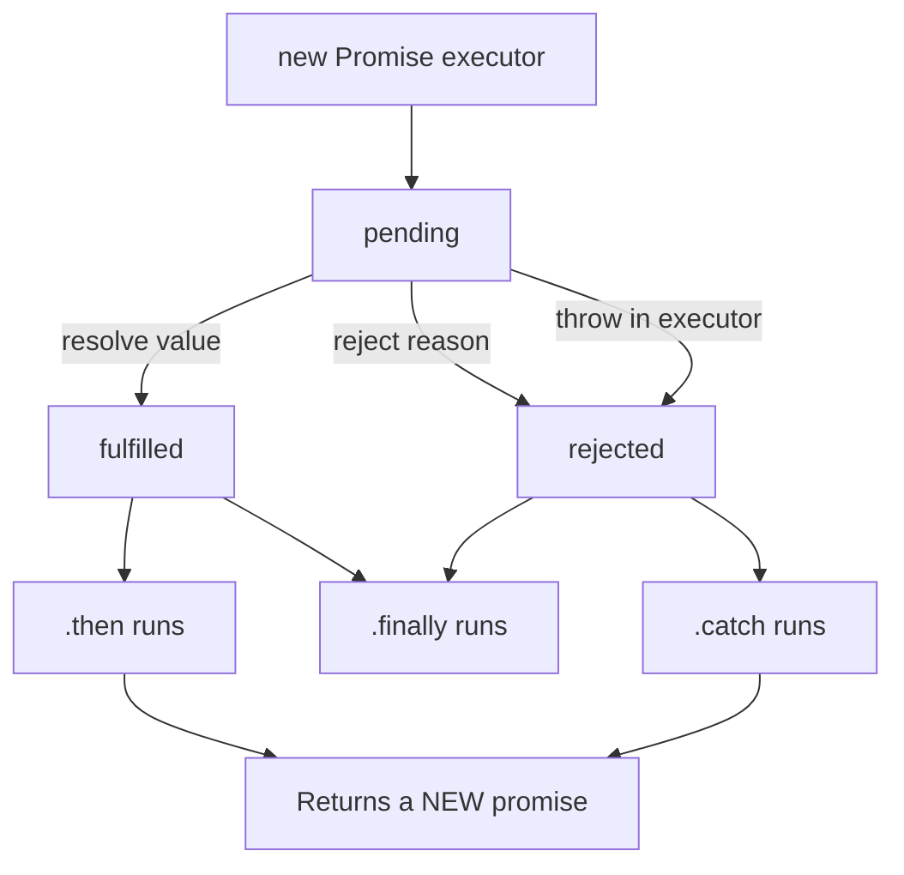

```
Microtask order:
  sync code  →  .then/.catch callbacks  →  setTimeout callbacks
```

### 📊 Promise vs callback

| Aspect | Callback | Promise |
|---|---|---|
| Composition | Manual nesting | `.then` chaining |
| Error handling | Per-callback manually | Single `.catch` |
| Inversion of control | High | Lower (settled once) |
| Readability | ↓ with depth | ✅ flat chains |
| Cancellation | Manual | Needs `AbortController` |

### 🎯 Interview questions

| Question | Answer |
|---|---|
| What is a promise? | An object representing eventual completion/failure of async work. |
| Can a promise be cancelled? | Not natively; use `AbortController` or a race with a rejection. |
| Difference between `all` and `allSettled`? | `all` rejects on the first failure; `allSettled` waits for every result. |
| What does `Promise.race([])` do? | Never settles. |
| Are `.then` callbacks sync or async? | Always async — scheduled as microtasks. |
| What is a thenable? | Any object with a `.then` method. |
| Does `.catch` catch errors from a previous `.then`? | Yes, if the rejection happened upstream in the chain. |
| What's the difference between `.finally` value? | `.finally` doesn't change the value; it passes it through. |
| What happens if you throw inside `.then`? | The returned promise rejects with that error. |
| How do you run promises in parallel? | `Promise.all([p1, p2])` (not `await p1; await p2;`). |
| What is `AggregateError`? | The rejection from `Promise.any` when every promise fails. |

### 💻 Coding problems

**P3.9** — Run promises sequentially and collect results.

```js
const tasks = [() => Promise.resolve(1), () => Promise.resolve(2)];
const results = [];
for (const task of tasks) results.push(await task());
console.log(results); // [1, 2]
```

**P3.10** — Limit concurrency to 2.

```js
async function pool(tasks, limit) {
  const results = [];
  let i = 0;
  const workers = Array.from({ length: Math.min(limit, tasks.length) }, async () => {
    while (i < tasks.length) {
      const index = i++;
      results[index] = await tasks[index]();
    }
  });
  await Promise.all(workers);
  return results;
}
```

**P3.11** — Timeout a promise.

```js
function withTimeout(promise, ms) {
  return Promise.race([
    promise,
    new Promise((_, reject) => setTimeout(() => reject(new Error("timeout")), ms)),
  ]);
}
```

---

## 19. `async` / `await`

### 🟢 ELI5
`async/await` lets you write async code that **reads top-to-bottom** like a recipe. `await` means "pause this function until the buzzer goes off" — without blocking the whole program.

### 📊 `async/await` rules

| Rule | Detail |
|---|---|
| `async function` | Always returns a promise |
| Returned value | Wrapped in `Promise.resolve(value)` |
| Thrown error | Becomes `Promise.reject(error)` |
| `await` outside async | Allowed only in ESM top-level, not CommonJS |
| `await` on non-promise | Resolves immediately |
| Error handling | `try/catch` or `.catch()` |
| Parallelism | Use `Promise.all`, not sequential `await`s |

### 📊 Sequential vs parallel

| Pattern | Code | Time for 3×100 ms |
|---|---|---|
| Sequential | `await a(); await b(); await c();` | ~300 ms |
| Parallel | `await Promise.all([a(), b(), c()])` | ~100 ms |
| Fire-and-forget | `a();` (no await) | 0 ms (risk: unhandled rejection) |

### 🧪 Walkthrough

```js
async function getUsers() {
  try {
    const res = await fetch("https://api.example.com/users");
    if (!res.ok) throw new Error(`HTTP ${res.status}`);
    return await res.json();
  } catch (err) {
    console.error("fetch failed:", err.message);
    throw err;             // rethrow so callers know
  } finally {
    console.log("request finished");
  }
}
```

```js
// Sequential — each waits
async function sequential() {
  const a = await step("A");
  const b = await step("B");
  return [a, b];
}

// Parallel — start all, then wait
async function parallel() {
  const [a, b] = await Promise.all([step("A"), step("B")]);
  return [a, b];
}
```

```js
// Retry with backoff — common for flaky APIs
async function retry(fn, attempts = 3, delay = 500) {
  for (let i = 1; i <= attempts; i++) {
    try {
      return await fn();
    } catch (err) {
      if (i === attempts) throw err;
      await new Promise(r => setTimeout(r, delay * i));
    }
  }
}
```

### 🔁 Async execution flow

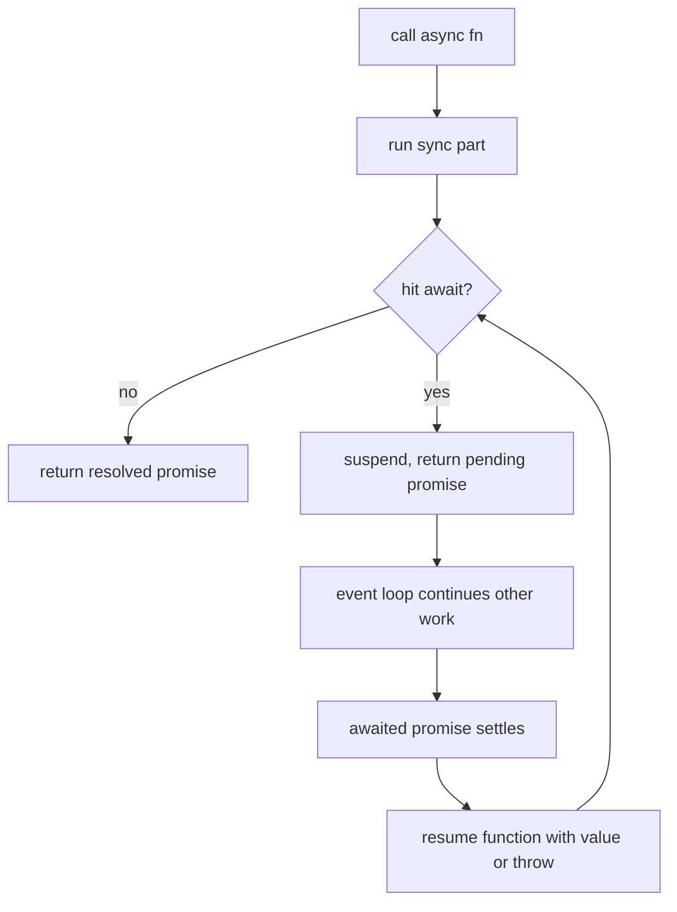

### 📊 `async/await` vs `.then`

| Aspect | `async/await` | `.then()` |
|---|---|---|
| Readability | ✅ Linear | Chained |
| Debugging | ✅ Normal stack traces | Harder |
| `try/catch` | ✅ Works | Needs `.catch` |
| Parallel | `Promise.all` | `Promise.all` |
| Loop with await | ✅ `for…of` | Tricky with `forEach` ⚠️ |

> ⚠️ `arr.forEach(async x => await work(x))` does **not** wait. Use `for…of` or `Promise.all(arr.map(...))`.

### 🎯 Interview questions

| Question | Answer |
|---|---|
| What does `async` return? | Always a promise. |
| Can you use `await` at the top level? | Yes, in ES modules and modern Node REPL. |
| Does `await` block the thread? | No — it suspends only that function; the event loop keeps running. |
| How do you run tasks in parallel? | `Promise.all([...])`; don't await each sequentially. |
| Does `try/catch` catch a rejected await? | Yes. |
| What is an unhandled rejection? | A rejected promise with no `.catch`/`try` — can crash Node. |
| `forEach` with async — what happens? | The callback returns promises nobody awaits, so the loop finishes early. |
| How do you await inside a loop sequentially? | `for (const x of arr) await fn(x)`. |
| What's the difference between `return await fn()` and `return fn()` in try? | `return await` lets `catch` see the rejection; without `await`, the error escapes. |
| How do you cancel an async operation? | `AbortController` passed into `fetch`. |

### 💻 Coding problems

**P3.12** — Fetch N URLs in parallel with per-URL error isolation.

```js
async function fetchAll(urls) {
  const settled = await Promise.allSettled(urls.map(u => fetch(u)));
  return settled.map((r, i) => ({
    url: urls[i],
    ok: r.status === "fulfilled",
    error: r.status === "rejected" ? r.reason.message : null,
  }));
}
```

**P3.13** — Sleep helper.

```js
const sleep = ms => new Promise(resolve => setTimeout(resolve, ms));
await sleep(1000);
```

**P3.14** — Retry a flaky function three times.

```js
async function retry(fn, times = 3) {
  let lastError;
  for (let i = 0; i < times; i++) {
    try { return await fn(); } catch (e) { lastError = e; }
  }
  throw lastError;
}
```

---

## 20. Modules (`export` / `import`)

### 🟢 ELI5
Modules are **Lego bags**: each file packages pieces and decides which pieces other files may take. `export` = "this piece is available"; `import` = "give me that piece".

### 📊 Export styles

| Style | Syntax | Import |
|---|---|---|
| Named export | `export const add = ...` | `import { add } from "./m.js"` |
| Multiple named | `export { add, sub }` | `import { add, sub } from "./m.js"` |
| Rename on export | `export { add as plus }` | `import { plus } from "./m.js"` |
| Default export | `export default function() {}` | `import anything from "./m.js"` |
| Re-export | `export * from "./m.js"` | Barrel files |
| Namespace | — | `import * as utils from "./utils.js"` |
| Dynamic | — | `const m = await import("./m.js")` |

### 📊 CommonJS vs ES Modules

| Aspect | CommonJS | ES Modules |
|---|---|---|
| Syntax | `require` / `module.exports` | `import` / `export` |
| Loading | Synchronous | Asynchronous |
| File ext | `.js` (default in Node CJS) | `.mjs` or `"type": "module"` |
| Top-level `await` | ❌ | ✅ |
| Static analysis | Limited | ✅ Tree-shaking |
| `this` at top level | `module.exports` | `undefined` |
| Use in browsers | ❌ (needs bundler) | ✅ Native |

### 🧪 Walkthrough

```js
// utils.js
export const baseURL = "https://api.example.com";
export function buildUrl(path) { return `${baseURL}${path}`; }
export default class ApiClient { /* ... */ }
```

```js
// test.js
import ApiClient, { baseURL, buildUrl } from "./utils.js";
import * as utils from "./utils.js";

console.log(baseURL);
console.log(buildUrl("/users"));
console.log(utils.buildUrl("/health"));
new ApiClient();
```

```js
// logger.js — named + default
export default function log(msg) { console.log(msg); }
export const level = "info";
```

```js
// CommonJS equivalent
const { buildUrl } = require("./utils");
module.exports = { buildUrl };
```

### 🔁 Module resolution flow

```
 import x from "./utils.js"
        │
        ▼
 resolve path (relative / package / built-in)
        │
        ▼
 load file (cache hit? reuse)
        │
        ▼
 parse + evaluate module body ONCE
        │
        ▼
 bind exports → your local names
```

### 📊 Common errors

| Error | Cause | Fix |
|---|---|---|
| `Cannot use import statement outside a module` | CJS file using ESM syntax | Rename to `.mjs` or add `"type": "module"` |
| `ERR_REQUIRE_ESM` | `require()` of an ESM package | Use `import` or dynamic `import()` |
| `does not provide an export named` | Wrong name / default vs named mix-up | Check the export style |
| `Cannot find module` | Wrong path or missing extension | Verify path; include `.js` in ESM |
| Circular import `undefined` | Modules import each other | Restructure dependencies |

### 🎯 Interview questions

| Question | Answer |
|---|---|
| Named vs default export? | Named requires the exact name (or alias); default can be imported under any name, one per module. |
| Can a module have multiple default exports? | No — exactly one. |
| Are ES modules evaluated once? | Yes, cached after the first evaluation. |
| What is tree-shaking? | Dead-code elimination enabled by static ESM imports. |
| Why is ESM async-loaded? | To support browsers and top-level `await`. |
| What does `import * as ns` give you? | A namespace object holding all named exports (plus `default`). |
| Can you import conditionally? | Yes — `await import()` returns a promise. |
| Is `require` hoisted? | It executes where written, but is often placed at the top by convention. |
| What is a barrel file? | An `index.js` that re-exports modules for cleaner imports. |
| How do circular imports behave? | Partially initialised modules can yield `undefined` bindings. |

### 💻 Coding problems

**P3.15** — Create `logger.js` with named + default exports and a barrel `index.js`.

```js
// logger.js
export const levels = ["info", "warn", "error"];
export function log(level, msg) { console.log(`[${level}] ${msg}`); }
export default log;
```

```js
// index.js
export * from "./logger.js";
export { default as log } from "./logger.js";
```

**P3.16** — Load a module dynamically based on environment.

```js
const env = process.env.NODE_ENV ?? "dev";
const { config } = await import(`./config.${env}.js`);
console.log(config);
```

⚡ **TL;DR (Part 3):** Functions are values; arrows capture `this` lexically. Closures keep captured variables alive. Callbacks are the low-level async primitive, promises add composition, `async/await` adds readability. `Promise.all` = parallel, `allSettled` = full report, `race` = first. Modules split code; ESM is static and async, CJS is dynamic and sync.

---

# PART 4 — OOP & TYPESCRIPT

---

## 21. Classes and Objects

### 🟢 ELI5
A **class** is a cookie cutter. **Objects** are the cookies. The `constructor` is the first thing that happens when a cookie is cut, and `this` means "this particular cookie".

### 📊 Class members

| Member | Syntax | Belongs to | Purpose |
|---|---|---|---|
| Constructor | `constructor(args){}` | Instance creation | Initialise fields |
| Instance field | `name = "x"` | Each object | Per-object state |
| Method | `greet(){}` | Prototype | Shared behaviour |
| `static` field/method | `static count = 0` | Class itself | Shared state/utilities |
| Getter | `get value(){}` | Prototype | Computed/read-only property |
| Setter | `set value(v){}` | Prototype | Validated write |
| Private field | `#secret` | Each object | True privacy |
| Computed name | `[key](){}` | Prototype | Dynamic method names |

### 📊 Instance vs static

| Aspect | Instance | Static |
|---|---|---|
| Access via | `obj.member` | `ClassName.member` |
| `this` | The instance | The class |
| Memory | Per instance | One copy |
| Use for | State/behaviour of a thing | Counters, factories, utilities |
| Example | `user.name` | `Math.max`, `User.count` |

### 🧪 Walkthrough

```js
class TestCase {
  static total = 0;               // shared across all instances

  #retries = 0;                   // truly private

  constructor(name, priority = "P2") {
    this.name = name;
    this.priority = priority;
    this.status = "pending";
    TestCase.total++;
  }

  run() {
    this.status = "running";
    return `${this.name} running`;
  }

  get isDone() {
    return this.status === "pass" || this.status === "fail";
  }

  retry() {
    this.#retries++;
    return this.#retries;
  }

  static reset() { TestCase.total = 0; }
}

const t = new TestCase("login");
console.log(t.run());        // "login running"
console.log(t.isDone);       // false
console.log(t.retry());      // 1
console.log(TestCase.total); // 1
// console.log(t.#retries);  // ❌ SyntaxError — private
```

### 🔁 Object creation flow

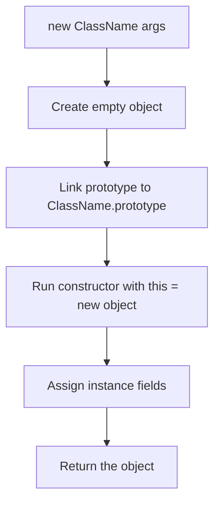

### 🎯 Interview questions

| Question | Answer |
|---|---|
| What is a class in JS? | Syntactic sugar over prototype-based inheritance. |
| What does `new` do? | Creates an object, links the prototype, runs the constructor, returns the object. |
| What is `this` in a method? | The object before the dot at call time. |
| Instance vs static method? | Instance methods use per-object state; static methods belong to the class. |
| Can a class have multiple constructors? | No — one constructor; use defaults/overloads at the TS level. |
| What are private `#fields`? | Truly private fields enforced by the language (not just convention). |
| Difference between a class and an object literal? | A class is a template with a prototype; a literal is a one-off instance. |
| What are getters/setters for? | Computed/validated access while keeping the property syntax. |
| Are class declarations hoisted? | Yes, but stay in the TDZ until evaluated. |
| Can methods be added after definition? | Yes — via `ClassName.prototype.newMethod = ...` (not recommended). |

### 💻 Coding problems

**P4.1** — Build a `Counter` class with private state and static instance count.

```js
class Counter {
  static instances = 0;
  #count = 0;
  constructor() { Counter.instances++; }
  inc() { return ++this.#count; }
  get value() { return this.#count; }
}
const a = new Counter(), b = new Counter();
a.inc();
console.log(a.value, Counter.instances); // 1 2
```

**P4.2** — BankAccount with validated withdrawals.

```js
class BankAccount {
  #balance = 0;
  constructor(owner) { this.owner = owner; }
  deposit(n) {
    if (n <= 0) throw new RangeError("deposit must be positive");
    this.#balance += n;
  }
  withdraw(n) {
    if (n > this.#balance) throw new Error("insufficient funds");
    this.#balance -= n;
    return this.#balance;
  }
  get balance() { return this.#balance; }
}
```

---

## 22. Encapsulation

### 🟢 ELI5
Encapsulation is a **TV remote**: you press "volume up" without touching the circuits. The internals are hidden; only safe buttons are exposed. Code outside can't corrupt the state.

### 📊 Encapsulation techniques

| Technique | Privacy level | Runtime enforced? | Example |
|---|---|---|---|
| `#private` field | Strong | ✅ | `#balance` |
| Closure variable | Strong | ✅ | IIFE/module pattern |
| `_convention` | Weak (hint only) | ❌ | `_balance` |
| TS `private` | Compile-time | ❌ (gone at runtime) | `private balance` |
| TS `protected` | Compile-time | ❌ | `protected timeout` |
| Read-only accessor | Read-only | ✅ | `get balance()` |

### 📊 Why encapsulate

| Benefit | Effect |
|---|---|
| Data integrity | Invalid states become impossible |
| Easier refactor | Internals can change without breaking callers |
| Smaller API surface | Fewer things to misuse |
| Testing | Public API is the contract to test |
| Debugging | Single place to validate/mutate state |

### 🧪 Walkthrough

```js
class BankAccount {
  #balance;
  #history = [];

  constructor(initial = 0) {
    if (initial < 0) throw new RangeError("initial balance cannot be negative");
    this.#balance = initial;
  }

  deposit(amount) {
    this.#assertPositive(amount);
    this.#balance += amount;
    this.#history.push({ type: "deposit", amount });
  }

  withdraw(amount) {
    this.#assertPositive(amount);
    if (amount > this.#balance) throw new Error("insufficient funds");
    this.#balance -= amount;
    this.#history.push({ type: "withdraw", amount });
  }

  get balance() { return this.#balance; }
  get statement() { return [...this.#history]; }  // copy, not the internal array

  #assertPositive(n) {
    if (typeof n !== "number" || n <= 0) throw new TypeError("amount must be > 0");
  }
}

const acc = new BankAccount(100);
acc.deposit(50);
acc.withdraw(30);
console.log(acc.balance);   // 120
// acc.#balance = 9999;     // ❌ impossible from outside
```

### 🔁 Encapsulation boundary

```
        OUTSIDE                    │           INSIDE
 ┌─────────────────────────────┐   │   ┌──────────────────────────┐
 │ acc.deposit(50)  ───────────┼──▶│──▶│ validate → update state  │
 │ acc.balance      ◀──────────┼───│───│ getter returns value     │
 │ acc.#balance     ✖ blocked  │   │   │ #balance, #history       │
 └─────────────────────────────┘   │   └──────────────────────────┘
                                   │
                            public API wall
```

### 🎯 Interview questions

| Question | Answer |
|---|---|
| What is encapsulation? | Bundling data with the methods that operate on it and restricting direct access. |
| How is encapsulation achieved in JS? | `#private` fields, closures, or TS access modifiers (compile-time only). |
| Does TS `private` survive compilation? | No — it's erased; runtime JS can still reach the property. |
| `_name` — is that private? | No, it's a naming convention only. |
| Why return a copy of an internal array? | Prevents external mutation of internal state. |
| How do you expose read-only state? | A getter with no setter (`get balance()`). |
| Encapsulation vs abstraction? | Encapsulation hides *data*; abstraction hides *complexity* behind a simpler model. |
| Where do you validate input? | At the public boundary, inside setter methods/constructors. |
| How do you test private logic? | Test through the public API (better) or refactor the logic into a testable helper. |
| Encapsulation in a POM? | Keep locators private; expose actions/assertions only. |

### 💻 Coding problems

**P4.3** — `Temperature` class that stores Celsius privately but exposes `fahrenheit`.

```js
class Temperature {
  #celsius;
  constructor(celsius) { this.#celsius = celsius; }
  get celsius() { return this.#celsius; }
  get fahrenheit() { return this.#celsius * 9 / 5 + 32; }
  set fahrenheit(f) { this.#celsius = (f - 32) * 5 / 9; }
}
const t = new Temperature(25);
console.log(t.fahrenheit); // 77
t.fahrenheit = 212;
console.log(t.celsius);    // 100
```

---

## 23. Inheritance

### 🟢 ELI5
Inheritance is **"like your parents"**: a child class gets the parent's traits for free, can add its own, and can override a trait it wants to do differently. `super` means "ask my parent".

### 📊 Inheritance types

| Type | Shape | JS support |
|---|---|---|
| Single | A → B | ✅ `class B extends A` |
| Multi-level | A → B → C | ✅ |
| Hierarchical | A → B, A → C | ✅ |
| Multiple | A + B → C | ❌ Classes: no. ✅ Mixins via composition |
| Hybrid | Combination | ⚠️ Via mixins |

### 📊 `super` usage

| Context | Meaning |
|---|---|
| `super()` in constructor | Call parent constructor — **required before `this`** in a subclass |
| `super.method()` | Call the parent's version of a method |
| `super.field` (TS) | Access parent field (not valid for `#private`) |

### 🧪 Walkthrough

```js
class BaseTest {
  constructor(name) {
    this.name = name;
    this.status = "pending";
  }
  setup() { console.log(`[${this.name}] setup`); }
  execute() { console.log(`[${this.name}] execute`); }
  teardown() { console.log(`[${this.name}] teardown`); }
  run() {
    this.setup();
    this.execute();
    this.teardown();
    this.status = "done";
  }
}

class UITest extends BaseTest {
  constructor(name, browser) {
    super(name);              // must come first
    this.browser = browser;
  }
  setup() {
    super.setup();            // reuse parent behaviour
    console.log(`  launch ${this.browser}`);
  }
  execute() {
    console.log(`  click, type, assert in ${this.browser}`);
  }
}

class APITest extends BaseTest {
  execute() {
    console.log(`  GET /users → 200`);
  }
}

const ui = new UITest("login", "chromium");
ui.run();
const api = new APITest("users-api");
api.run();
```

### 🔁 Inheritance hierarchy

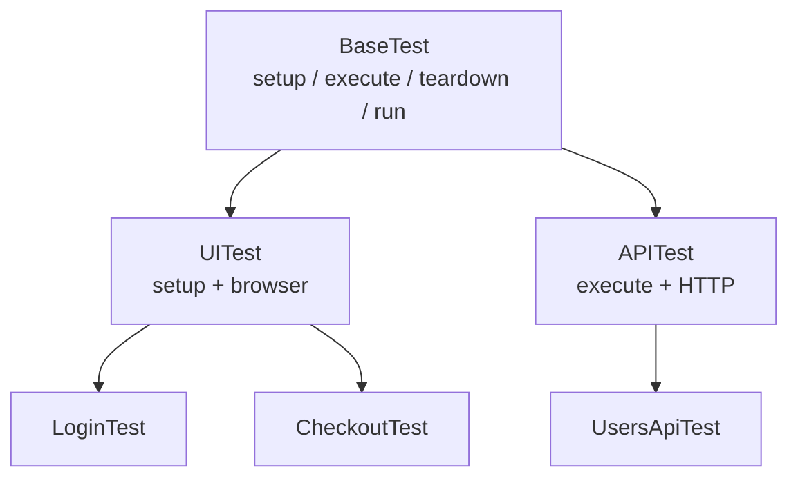

### 📊 Inheritance vs composition

| Aspect | Inheritance ("is-a") | Composition ("has-a") |
|---|---|---|
| Relationship | Child **is a** parent | Class **has a** helper |
| Coupling | Tight | Loose |
| Flexibility | Single parent only | Mix and match |
| Fragile base class | ⚠️ Yes | ❌ No |
| JS support | `extends` | Fields holding objects |
| Preferred by modern design | When the is-a is real | ✅ Default choice |

### 🎯 Interview questions

| Question | Answer |
|---|---|
| Does JS support multiple inheritance? | No — one `extends`. Use mixins/composition. |
| Why must `super()` be first? | `this` isn't created until the parent constructor runs. |
| What is method overriding? | Redefining an inherited method in the child. |
| What is the prototype chain? | The lookup path: instance → `Class.prototype` → parent prototype → `Object.prototype`. |
| `extends` vs `implements` (TS)? | `extends` inherits implementation; `implements` only enforces a contract. |
| Can a subclass omit the constructor? | Yes — it implicitly calls `super(...args)`. |
| What does `super.method()` do? | Calls the parent's implementation, even when overridden. |
| Can you extend a built-in like `Array`? | Yes, but methods returning new arrays may not use your subclass. |
| What is the fragile base class problem? | Parent changes silently break subclasses. |
| When avoid inheritance? | When the relationship isn't truly "is-a" or you need multiple behaviours. |
| How do you check inheritance? | `obj instanceof Parent`. |
| How does `instanceof` work? | Walks the prototype chain looking for `Parent.prototype`. |

### 💻 Coding problems

**P4.4** — Build a 3-level hierarchy: `Vehicle → Car → ElectricCar`.

```js
class Vehicle {
  constructor(brand) { this.brand = brand; }
  describe() { return `${this.brand} vehicle`; }
}
class Car extends Vehicle {
  constructor(brand, doors) { super(brand); this.doors = doors; }
  describe() { return `${super.describe()} with ${this.doors} doors`; }
}
class ElectricCar extends Car {
  constructor(brand, doors, range) { super(brand, doors); this.range = range; }
  describe() { return `${super.describe()}, ${this.range} km range`; }
}
console.log(new ElectricCar("Tesla", 4, 500).describe());
// "Tesla vehicle with 4 doors, 500 km range"
```

**P4.5** — Use a mixin to add logging to two unrelated classes.

```js
const withLogging = Base => class extends Base {
  log(msg) { console.log(`[${this.constructor.name}] ${msg}`); }
};
class ApiTest {}
class UiTest {}
const LoggedApi = withLogging(ApiTest);
new LoggedApi().log("GET /users");
```

---

## 24. Polymorphism

### 🟢 ELI5
Polymorphism means **"many forms"**: you say "do your thing" and each type does it its own way. Press "play" on different devices — same button, different result.

### 📊 Types of polymorphism

| Type | Mechanism | JS/TS example |
|---|---|---|
| Compile-time (overloading) | Same name, different signatures | TS overload signatures only (no runtime overloads) |
| Runtime (overriding) | Subclass redefines a method | `class Dog extends Animal { speak() }` |
| Parametric | Generic over type | `function identity<T>(x: T): T` |
| Duck typing | "If it quacks like a duck" — shape matters | Any object with the needed method |
| Ad-hoc (coercion) | Operators adapt to operands | `1 + 1` vs `"a" + "b"` |

### 📊 Method overloading vs overriding

| Aspect | Overloading | Overriding |
|---|---|---|
| Where | Same class | Parent → child |
| Signature | Different params | Same name + params |
| Runtime | ❌ JS has no real overloading | ✅ Dynamic dispatch |
| TS support | ✅ Declarations only | ✅ |
| Example | `add(a:number):number; add(a:string):string;` | `speak()` in `Dog` |

### 🧪 Walkthrough

```js
class Animal {
  constructor(name) { this.name = name; }
  speak() { return `${this.name} makes a sound`; }
}

class Dog extends Animal {
  speak() { return `${this.name} barks`; }
}

class Cat extends Animal {
  speak() { return `${this.name} meows`; }
}

const animals = [new Dog("Rex"), new Cat("Milo"), new Animal("X")];
animals.forEach(a => console.log(a.speak()));
// Rex barks / Milo meows / X makes a sound
```

```js
// Duck typing — no inheritance required
function runTest(page) {
  page.goto();     // any object with goto() works
  page.click();
}
runTest({ goto() {}, click() {} });
```

```ts
// TS overload signatures
function toArray(value: string): string[];
function toArray(value: number): number[];
function toArray(value: string | number): (string | number)[] {
  return Array.isArray(value) ? value : [value];
}
```

### 🔁 Dynamic dispatch

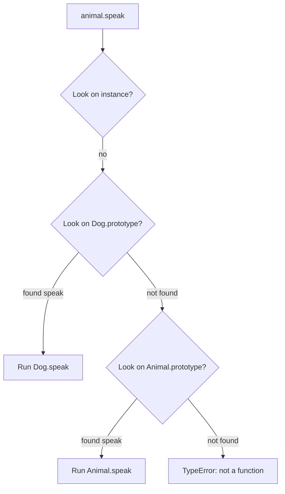

### 📊 Polymorphism in a test framework

| Layer | Polymorphic point |
|---|---|
| Pages | `BasePage.open()` → each page's own URL |
| Browsers | `BrowserFactory.create("chrome" \| "firefox")` |
| Environments | `ConfigProvider.get()` for dev/stage/prod |
| Reporters | `reporter.report(result)` for console/HTML/JSON |
| Assertions | `expect(value, message)` generic across types |

### 🎯 Interview questions

| Question | Answer |
|---|---|
| What is polymorphism? | One interface, multiple implementations. |
| Does JS support method overloading? | Not natively; simulate with optional params, rest args, or TS overload signatures. |
| Overloading vs overriding? | Overloading = same name, different params; overriding = replacing a parent method. |
| What is duck typing? | If an object has the methods you call, its class doesn't matter. |
| How does JS resolve overridden methods? | Prototype chain lookup at call time (dynamic dispatch). |
| Can a static method be overridden? | It can be shadowed, but there's no dynamic dispatch for statics. |
| Polymorphism vs inheritance? | Inheritance is one way to achieve polymorphism; interfaces/duck typing are others. |
| How does polymorphism help testing? | Swap real pages/APIs for fakes without changing test code. |
| What is an abstract method's role? | It forces subclasses to provide their own implementation. |
| Give a QA example. | A `Page` interface with `open()`, implemented differently per page. |

### 💻 Coding problems

**P4.6** — Shape area polymorphism.

```js
class Shape { area() { throw new Error("implement area()"); } }
class Circle extends Shape {
  constructor(r) { super(); this.r = r; }
  area() { return Math.PI * this.r ** 2; }
}
class Rect extends Shape {
  constructor(w, h) { super(); this.w = w; this.h = h; }
  area() { return this.w * this.h; }
}
const shapes = [new Circle(1), new Rect(2, 3)];
console.log(shapes.map(s => s.area().toFixed(2))); // ["3.14","6.00"]
```

**P4.7** — Strategy pattern (polymorphic behaviour injection).

```js
const strategies = {
  chrome: () => console.log("launch chromium"),
  firefox: () => console.log("launch firefox"),
  api: () => console.log("no browser, HTTP only"),
};
const run = (mode, fn = strategies[mode]) => {
  if (!fn) throw new Error(`unknown mode: ${mode}`);
  fn();
};
run("chrome");
```

---

## 25. OOP Interview Puzzles

### 🟢 ELI5
These are the quick-fire questions interviewers use to check whether you understand `this`, prototypes, and class mechanics — not just syntax.

### 📊 Puzzle table

| # | Question | Answer |
|---|---|---|
| 1 | `const f = obj.method; f();` — what is `this`? | `undefined` (strict) or global — the call site lost the object. |
| 2 | `this` inside an arrow in a method? | Lexical — the enclosing `this`, not the object. |
| 3 | `typeof class A {}`? | `"function"` — classes are functions. |
| 4 | `A.prototype.constructor === A`? | `true`. |
| 5 | Can you call a class without `new`? | No — `TypeError: Class constructor cannot be invoked without 'new'`. |
| 6 | `class B extends A {}` with no constructor? | Implicitly calls `super(...args)`. |
| 7 | Two instances share methods? | Yes — methods live on the prototype; fields are per-instance. |
| 8 | `obj.hasOwnProperty("method")` for a class method? | `false` — it's on the prototype (use `in`). |
| 9 | What does `Object.create(proto)` do? | Creates an object whose prototype is `proto`. |
| 10 | `new` with a function returning an object? | That returned object replaces `this`. |
| 11 | `private` vs `#private`? | TS `private` is compile-time; `#` is runtime-enforced. |
| 12 | Can a static method use `this`? | Yes — refers to the class (or subclass when inherited). |
| 13 | Does `super` work in static methods? | Yes — refers to the parent class. |
| 14 | What is `instanceof` checking? | Prototype chain membership. |
| 15 | Is `prototype` the same as `__proto__`? | No — `prototype` is on constructors; `__proto__` is on instances. |

### 🧪 Classic puzzles

```js
// 1. Lost `this`
const user = {
  name: "Shashi",
  greet() { return this.name; },
};
const g = user.greet;
console.log(g());                 // undefined (strict) / global name
console.log(user.greet());        // "Shashi"
console.log(g.call(user));        // "Shashi"

// 2. Arrow vs method
const obj = {
  name: "QA",
  arrow: () => this.name,
  method() { return this.name; },
};
console.log(obj.arrow());         // undefined — lexical this
console.log(obj.method());        // "QA"

// 3. Prototype sharing
class A { hello() { return "hi"; } }
const a1 = new A(), a2 = new A();
console.log(a1.hello === a2.hello); // true (same prototype method)

// 4. Constructor return
function Weird() { this.x = 1; return { y: 2 }; }
console.log(new Weird());         // { y: 2 } — object return wins
```

### 🎯 Interview questions

| Question | Answer |
|---|---|
| Why does a detached method lose `this`? | `this` is bound at call time by the call site, not at definition. |
| How do you permanently bind `this`? | `bind`, an arrow wrapper, or class fields with arrows. |
| Are class methods enumerable? | No — non-enumerable by default. |
| What is the difference between `__proto__` and `prototype`? | `prototype` is a property of constructors; `__proto__` is the actual link on objects. |
| What does `Object.getPrototypeOf(obj)` return? | `Class.prototype` for instances. |
| Can you override a getter? | Yes, in a subclass or instance definition. |
| Is `super` dynamic? | It's statically bound to the parent of the defining class. |
| Can you have a private static field? | Yes — `static #count`. |
| What happens if two classes define the same static? | The child's shadows the parent's. |

---

## 26. TypeScript Basics

### 🟢 ELI5
TypeScript is JavaScript with **labels on the boxes**. The labels don't change how the box works — they just let the editor shout at you *before* you run the code. All labels vanish at runtime.

### 📊 JS vs TS

| Aspect | JavaScript | TypeScript |
|---|---|---|
| Types | Dynamic, runtime | Static, compile-time |
| Runs directly | ✅ | ❌ compiles to JS |
| Errors caught | At runtime | At compile time (mostly) |
| Tooling | Basic | Autocomplete, refactors, go-to-definition |
| File extension | `.js` | `.ts` / `.tsx` |
| Extra features | — | Interfaces, enums, generics, access modifiers |
| Runtime output | Same | Types erased; only JS remains |

### 📊 Type taxonomy

| Type | Meaning | Example |
|---|---|---|
| `string` | Text | `"abc"` |
| `number` | All numbers | `42`, `3.14` |
| `boolean` | `true`/`false` | `true` |
| `null` / `undefined` | Absence | `null` |
| `any` | Opt out of checking ⚠️ | `let x: any` |
| `unknown` | Safe `any` — must narrow first | `let x: unknown` |
| `never` | Can never occur | `function fail(): never` |
| `void` | Returns nothing | `function log(): void` |
| `object` | Non-primitive | `{ a: 1 }` |
| `Array<T>` / `T[]` | Homogeneous list | `number[]` |
| Tuple | Fixed-length, typed positions | `[string, number]` |
| Union | One of several | `"a" \| "b"` |
| Intersection | All combined | `A & B` |
| Literal | Exact value | `"PASS"` |
| `enum` | Named constants | `enum Status { Pass }` |
| `type` alias | Name for a type | `type ID = string \| number` |
| `interface` | Shape contract | `interface User { name: string }` |

### 📊 `any` vs `unknown` vs `never`

| Type | Assignable to anything? | Can call/access? | Use when |
|---|---|---|---|
| `any` | ✅ | ✅ (unchecked) | Migrating legacy JS |
| `unknown` | ❌ must narrow | ❌ until narrowed | External input (API/JSON) |
| `never` | ✅ (bottom type) | N/A | Impossible states, exhaustive checks |

```ts
let a: any = "x";       a.toFixed();   // compiles, crashes at runtime
let u: unknown = "x";   // u.toFixed();  // ❌ must narrow
if (typeof u === "string") u.toUpperCase(); // ✅
```

### 📊 `interface` vs `type`

| Feature | `interface` | `type` |
|---|---|---|
| Object shape | ✅ | ✅ |
| Declaration merging | ✅ | ❌ |
| Extends | `extends` | `&` intersection |
| Unions | ❌ | ✅ |
| Tuples / primitives alias | ❌ | ✅ |
| `implements` in class | ✅ | ✅ |
| Best for | Public object contracts | Unions, aliases, complex types |

### 📊 Other type features

| Feature | Syntax | Purpose |
|---|---|---|
| Optional property | `{ name?: string }` | May be absent |
| Readonly | `readonly id: string` | No reassignment |
| Index signature | `{ [key: string]: number }` | Dynamic keys |
| Type assertion | `value as string` | You promise the type |
| Non-null assertion | `value!` | Strip `null`/`undefined` ⚠️ |
| `satisfies` | `const c = {...} satisfies Config` | Validate without widening |
| Generic | `<T>(x: T) => T` | Type parameter |
| Utility | `Partial<T>`, `Pick<T,K>`, `Omit<T,K>`, `Record<K,V>`, `Required<T>`, `Readonly<T>` | Type transformations |
| `keyof` | `keyof User` | Union of keys |
| `typeof` (type context) | `typeof user` | Type from a value |
| Conditional | `T extends U ? X : Y` | Type-level branching |
| Mapped | `{ [K in keyof T]: T[K] }` | Transform properties |

### 🧪 Walkthrough

```ts
type Status = "pass" | "fail" | "skip";

interface TestCase {
  readonly id: string;
  name: string;
  status: Status;
  priority?: 1 | 2 | 3;
  tags: string[];
}

function summarize(test: TestCase): string {
  const p = test.priority ?? 2;
  return `${test.id}: ${test.name} [${test.status}] P${p}`;
}

const t: TestCase = {
  id: "TC-1",
  name: "login",
  status: "pass",
  tags: ["smoke"],
};

console.log(summarize(t));

// Union narrowing
function format(value: string | number): string {
  return typeof value === "number" ? value.toFixed(2) : value.trim();
}

// Utility types
type TestPatch = Partial<Pick<TestCase, "name" | "status">>;
const patch: TestPatch = { status: "fail" };
```

### 📊 `tsconfig.json` essentials

| Option | Values | Effect |
|---|---|---|
| `target` | `ES2015`…`ESNext` | Output JS version |
| `module` | `CommonJS`, `ESNext`, `NodeNext` | Module system |
| `strict` | `true` | Turns on all strict checks |
| `noImplicitAny` | `true` | Error on inferred `any` |
| `strictNullChecks` | `true` | `null`/`undefined` are distinct |
| `outDir` | path | Where compiled JS goes |
| `rootDir` | path | Source root |
| `esModuleInterop` | `true` | Better CJS/ESM interop |
| `skipLibCheck` | `true` | Faster builds |
| `noEmit` | `true` | Type-check only |

### 🎯 Interview questions

| Question | Answer |
|---|---|
| Does TypeScript run in the browser? | No — it compiles to JavaScript first. |
| Are types present at runtime? | No — erased during compilation. |
| `any` vs `unknown`? | `any` disables checking; `unknown` requires narrowing. |
| `type` vs `interface`? | Interfaces merge and extend; types handle unions/tuples/aliases. |
| What is type inference? | TS deduces types from values without annotations. |
| What is type narrowing? | Refining a union using `typeof`, `instanceof`, `in`, or discriminants. |
| What is a discriminated union? | A union whose members share a literal tag field. |
| `never` use case? | Functions that always throw, or exhaustiveness checks. |
| What does `strict` enable? | `strictNullChecks`, `noImplicitAny`, `strictFunctionTypes`, and more. |
| Is `as` a cast? | No — an assertion; it doesn't convert at runtime. |
| What is `satisfies` for? | Validating a value against a type while preserving its literal type. |
| How do you type an API response? | `interface ApiResponse<T> { status: number; data: T }`. |

### 💻 Coding problems

**P4.8** — Type a discriminated union and handle all cases exhaustively.

```ts
type Result =
  | { kind: "pass"; duration: number }
  | { kind: "fail"; error: string }
  | { kind: "skip"; reason: string };

function report(r: Result): string {
  switch (r.kind) {
    case "pass": return `PASS in ${r.duration}ms`;
    case "fail": return `FAIL: ${r.error}`;
    case "skip": return `SKIP: ${r.reason}`;
    default: {
      const _exhaustive: never = r;
      return _exhaustive;
    }
  }
}
```

**P4.9** — Use utility types to build a patch type.

```ts
interface User { id: string; name: string; email: string; role: "qa" | "dev"; }
type UserPatch = Partial<Omit<User, "id">>;
type UserSummary = Pick<User, "id" | "name">;
type UserMap = Record<string, User>;
```

---

## 27. Interfaces & Abstraction

### 🟢 ELI5
An interface is a **job description**: it says which skills a candidate must have, not how they do the job. Any class with those skills qualifies. Abstraction means you deal with "send request" instead of sockets and headers.

### 📊 Interface capabilities

| Feature | Syntax | Use |
|---|---|---|
| Property | `name: string` | Data shape |
| Optional | `name?: string` | May be missing |
| Readonly | `readonly id: string` | Immutable |
| Method | `run(): void` | Behaviour contract |
| Call signature | `(x: number): string` | Callable object |
| Index signature | `[key: string]: string` | Dynamic keys |
| Extends | `interface B extends A` | Inheritance |
| Multiple extends | `interface C extends A, B` | Combine contracts |
| Class implements | `class X implements I` | Enforce shape |

### 📊 Interface vs abstract class

| Aspect | Interface | Abstract class |
|---|---|---|
| Contains implementation | ❌ (only signature) | ✅ (shared code allowed) |
| State/fields | ❌ (except readonly props) | ✅ |
| Multiple inheritance | ✅ `implements A, B` | ❌ single `extends` |
| Runtime existence | ❌ erased | ✅ real class |
| Constructor | ❌ | ✅ |
| Use for | Contracts, DI, DTOs | Shared base behaviour |
| `implements` vs `extends` | `implements` | `extends` |

### 🧪 Walkthrough — POM contract

```ts
interface Page {
  readonly url: string;
  open(): Promise<void>;
  isLoaded(): Promise<boolean>;
}

class LoginPage implements Page {
  readonly url = "/login";
  constructor(private page: any) {}
  async open() { await this.page.goto(this.url); }
  async isLoaded() { return this.page.isVisible("#login-form"); }
}

class DashboardPage implements Page {
  readonly url = "/dashboard";
  constructor(private page: any) {}
  async open() { await this.page.goto(this.url); }
  async isLoaded() { return this.page.isVisible("#widgets"); }
}

// Polymorphic use — works for any Page
async function visit(p: Page) {
  await p.open();
  if (!(await p.isLoaded())) throw new Error(`${p.url} not loaded`);
}

await visit(new LoginPage(page));
```

```ts
// Abstraction hiding complexity
interface HttpClient {
  get<T>(path: string): Promise<T>;
  post<T>(path: string, body: unknown): Promise<T>;
}

class FetchClient implements HttpClient {
  constructor(private baseURL: string, private token?: string) {}
  private async request<T>(path: string, init?: RequestInit): Promise<T> {
    const res = await fetch(this.baseURL + path, {
      ...init,
      headers: {
        "content-type": "application/json",
        ...(this.token ? { authorization: `Bearer ${this.token}` } : {}),
        ...init?.headers,
      },
    });
    if (!res.ok) throw new Error(`HTTP ${res.status}`);
    return res.json() as Promise<T>;
  }
  get<T>(path: string) { return this.request<T>(path); }
  post<T>(path: string, body: unknown) {
    return this.request<T>(path, { method: "POST", body: JSON.stringify(body) });
  }
}
```

### 🔁 Interface-driven design

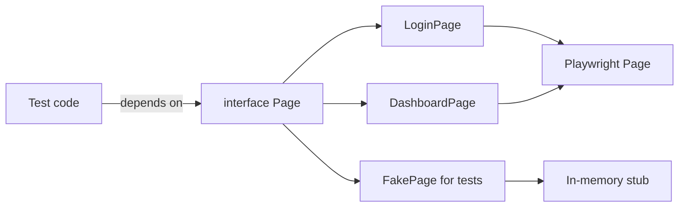

### 📊 Abstraction in QA frameworks

| Abstraction | Hides |
|---|---|
| Page Object | Selectors and DOM details |
| API client | HTTP verbs, headers, auth |
| Fixtures | Setup/teardown wiring |
| Config provider | Environment differences |
| Reporter interface | Output format |

### 🎯 Interview questions

| Question | Answer |
|---|---|
| What is an interface? | A compile-time contract describing shape/behaviour. |
| Can an interface have implementation? | No (TS interfaces are erased). |
| Can a class implement multiple interfaces? | Yes. |
| Can an interface extend a class? | Yes, but it captures only the members' types. |
| Why use interfaces in a POM? | Swap implementations and enforce consistency. |
| What is structural typing? | Compatibility by shape, not by declared name. |
| Interface vs type for unions? | Use `type` — interfaces can't express unions. |
| Do interfaces exist at runtime? | No — they're erased. |
| What is abstraction vs encapsulation? | Abstraction hides complexity; encapsulation hides data. |
| How do you mock a dependency typed by an interface? | Create an object literal implementing the interface. |

### 💻 Coding problems

**P4.10** — Define a `Reporter` interface and two implementations.

```ts
interface Reporter {
  onTestEnd(name: string, status: "pass" | "fail"): void;
}

class ConsoleReporter implements Reporter {
  onTestEnd(name: string, status: "pass" | "fail") {
    console.log(`${status === "pass" ? "✔" : "✘"} ${name}`);
  }
}

class JsonReporter implements Reporter {
  private rows: object[] = [];
  onTestEnd(name: string, status: "pass" | "fail") {
    this.rows.push({ name, status });
  }
  toJSON() { return JSON.stringify(this.rows, null, 2); }
}
```

**P4.11** — Mock an `HttpClient` for a unit test.

```ts
const fakeClient: HttpClient = {
  get: async <T>() => ({ id: 1 } as T),
  post: async <T>() => ({ ok: true } as T),
};
```

---

## 28. Enums

### 🟢 ELI5
An enum is a **labelled set of options** — like a traffic light: Red, Yellow, Green. You write the readable name; the compiler supplies the value.

### 📊 Enum kinds

| Kind | Syntax | Values | Runtime object? |
|---|---|---|---|
| Numeric | `enum Status { Pass, Fail }` | `0, 1` (auto) | ✅ |
| Numeric custom | `enum E { A = 10, B }` | `10, 11` | ✅ |
| String | `enum E { Pass = "PASS" }` | `"PASS"` | ✅ |
| Heterogeneous | `enum E { A = 1, B = "b" }` | mixed | ✅ (avoid) |
| `const enum` | `const enum E { A }` | inlined | ❌ erased |
| Union alternative | `type E = "PASS" \| "FAIL"` | literals | ❌ no object |

### 📊 Enum vs union type vs object constant

| Aspect | `enum` | Union of literals | `as const` object |
|---|---|---|---|
| Runtime object | ✅ | ❌ | ✅ |
| Reverse mapping (numeric) | ✅ | ❌ | ❌ |
| Bundle size | Larger | Smallest | Small |
| Exhaustiveness | ✅ | ✅ | ✅ |
| Iteration | `Object.values` | manual list | `Object.values` |
| Recommended | When you need a runtime map | ✅ Default for APIs | When you need values + types |

### 🧪 Walkthrough

```ts
enum TestStatus {
  Pass = "PASS",
  Fail = "FAIL",
  Skip = "SKIP",
  Pending = "PENDING",
  Blocked = "BLOCKED",
}

function badge(status: TestStatus): string {
  switch (status) {
    case TestStatus.Pass: return "✔";
    case TestStatus.Fail: return "✘";
    case TestStatus.Skip: return "⤼";
    case TestStatus.Pending: return "…";
    case TestStatus.Blocked: return "⛔";
  }
}

console.log(badge(TestStatus.Pass)); // "✔"
console.log(Object.values(TestStatus)); // ["PASS","FAIL","SKIP","PENDING","BLOCKED"]
```

```ts
enum Browser { Chromium = "chromium", Firefox = "firefox", WebKit = "webkit" }

const launchOptions: Record<Browser, { headless: boolean }> = {
  [Browser.Chromium]: { headless: true },
  [Browser.Firefox]:  { headless: true },
  [Browser.WebKit]:   { headless: false },
};
```

```ts
// Numeric enums have reverse mapping
enum Direction { Up, Down }
console.log(Direction.Up);        // 0
console.log(Direction[0]);        // "Up"
```

### 🔁 Enum usage flow

```
 source: enum TestStatus { Pass = "PASS" }
                 │
                 ▼
 compile:  var TestStatus = { Pass: "PASS" }   ← runtime object remains
                 │
                 ▼
 usage:    TestStatus.Pass  →  "PASS"
                 │
                 ▼
 switch exhaustiveness over the union of members
```

### 🎯 Interview questions

| Question | Answer |
|---|---|
| Are enums erased at runtime? | Regular enums no — they emit an object. `const enum` yes, they're inlined. |
| Numeric vs string enum? | Numeric supports reverse mapping; string is safer for APIs/logs. |
| Why avoid numeric enums? | Values can drift if members are reordered; logs show numbers. |
| Enum vs union type? | Unions are lighter and erased; enums provide a runtime object. |
| Can enums have computed members? | Only constant expressions; computed values need a `const` object. |
| How do you iterate an enum? | `Object.values(E)` for string enums. |
| Are enums type-safe? | Yes — a member's type accepts only that member. |
| What is `const enum` downside? | Breaks with `isolatedModules`/Babel; not inlined across packages reliably. |
| How do you map enum → config? | `Record<Enum, Config>`. |
| Can an enum member be a duplicate? | Numeric values may collide; string values may too — TS doesn't stop all duplicates. |

### 💻 Coding problems

**P4.12** — Map HTTP status groups to retry behaviour using an enum.

```ts
enum StatusGroup {
  Success = "2xx",
  Redirect = "3xx",
  Client = "4xx",
  Server = "5xx",
}

function shouldRetry(group: StatusGroup): boolean {
  return group === StatusGroup.Server || group === StatusGroup.Redirect;
}

function groupOf(code: number): StatusGroup {
  if (code >= 200 && code < 300) return StatusGroup.Success;
  if (code >= 300 && code < 400) return StatusGroup.Redirect;
  if (code >= 400 && code < 500) return StatusGroup.Client;
  return StatusGroup.Server;
}
```

---

## 29. Generics

### 🟢 ELI5
A generic is a **reusable box with a shape placeholder**: "any container of T". You decide `T` when you use it — `Box<string>`, `Box<number>` — and the compiler keeps the types straight.

### 📊 Generics in different positions

| Position | Syntax | Meaning |
|---|---|---|
| Function | `function id<T>(x: T): T` | Same type in and out |
| Multiple params | `<K, V>(k: K, v: V)` | Independent type params |
| Constraint | `<T extends object>` | T must satisfy a shape |
| Default | `<T = string>` | Fallback type |
| Interface | `interface ApiResponse<T>` | Generic contract |
| Class | `class Repo<T>` | Generic storage |
| Type alias | `type Pair<A, B> = [A, B]` | Generic structure |
| Arrow function | `<T,>(x: T) => x` | Note the comma in `.tsx` |

### 📊 Constraints and defaults

| Pattern | Example | Why |
|---|---|---|
| Must have a property | `<T extends { id: string }>` | Safe `t.id` |
| Must be an object | `<T extends object>` | Avoid primitives |
| Must be a key | `<K extends keyof T>` | Type-safe lookup |
| Default | `<T = unknown>` | Optional inference |
| `keyof` | `K extends keyof T` | Index by known key |

### 🧪 Walkthrough

```ts
// identity — preserves the exact input type
function identity<T>(value: T): T { return value; }
const n = identity(42);        // number
const s = identity("pass");    // "pass" (literal preserved)

// constrained
function pluck<T, K extends keyof T>(items: T[], key: K): T[K][] {
  return items.map(item => item[key]);
}
const tests = [{ id: 1, name: "a" }, { id: 2, name: "b" }];
console.log(pluck(tests, "name")); // ["a","b"]

// generic interface — API envelope
interface ApiResponse<T> {
  status: number;
  data: T;
  errors?: string[];
}

interface User { id: string; name: string }

async function getUsers(client: { get<T>(p: string): Promise<T> }) {
  const res = await client.get<ApiResponse<User[]>>("/users");
  return res.data;
}

// generic class
class Repository<T extends { id: string }> {
  private items = new Map<string, T>();
  save(item: T) { this.items.set(item.id, item); }
  find(id: string) { return this.items.get(id); }
  all(): T[] { return [...this.items.values()]; }
}

const repo = new Repository<User>();
repo.save({ id: "u1", name: "Shashi" });
console.log(repo.find("u1")?.name); // "Shashi"
```

### 🔁 Generic type inference

```
 call:      identity("pass")
                     │
                     ▼
 infer:     T = "pass"          (literal, not string)
                     │
                     ▼
 return:    "pass"
```

### 📊 Built-in generic utilities

| Utility | Effect |
|---|---|
| `Array<T>` | Typed list |
| `Promise<T>` | Async result type |
| `Record<K, V>` | Object with K keys and V values |
| `Partial<T>` | All props optional |
| `Required<T>` | All props required |
| `Readonly<T>` | All props readonly |
| `Pick<T, K>` | Subset of props |
| `Omit<T, K>` | Remove props |
| `Exclude<U, X>` | Remove union members |
| `Extract<U, X>` | Keep union members |
| `ReturnType<F>` | Function's return type |
| `Parameters<F>` | Tuple of param types |
| `Awaited<T>` | Unwrap promise type |

### 🎯 Interview questions

| Question | Answer |
|---|---|
| What is a generic? | A type parameter that lets code work with many types while staying type-safe. |
| Why not just use `any`? | `any` loses safety; generics preserve the relation between input and output. |
| What does `extends` mean in `<T extends X>`? | A constraint — T must be assignable to X. |
| What is `keyof`? | A union of an object type's keys. |
| How do you type a generic arrow in `.tsx`? | `<T,>(x: T) => x` (comma avoids JSX ambiguity). |
| Are generics available at runtime? | No — erased. |
| What is type inference for generics? | TS fills in T from the arguments. |
| What does `T[K]` mean? | The type of property K on T (indexed access). |
| How do you default a generic? | `<T = string>`. |
| When use generics in a POM? | Generic API clients, repositories, and page factories. |
| What is a generic constraint with `keyof` for? | Type-safe property picking/plucking. |

### 💻 Coding problems

**P4.13** — Write `groupBy` generically.

```ts
function groupBy<T, K extends keyof T>(items: T[], key: K): Record<string, T[]> {
  return items.reduce((acc, item) => {
    const k = String(item[key]);
    (acc[k] ??= []).push(item);
    return acc;
  }, {} as Record<string, T[]>);
}
console.log(groupBy([{ s: "pass" }, { s: "fail" }, { s: "pass" }], "s"));
// { pass: [...], fail: [...] }
```

**P4.14** — Generic `wrap` that turns any value into `{ value }`.

```ts
const wrap = <T>(value: T): { value: T } => ({ value });
console.log(wrap(1), wrap("a"));
```

---

## 30. `public` / `private` / `protected` / `readonly`

### 🟢 ELI5
Think of a company: **public** = the reception desk (anyone), **protected** = the staff room (this team and sub-teams), **private** = your locker (only you). **readonly** = a plaque you can read but not rewrite.

### 📊 Access modifiers

| Modifier | Same class | Subclass | Outside | Runtime-enforced? |
|---|---|---|---|---|
| `public` (default) | ✅ | ✅ | ✅ | — |
| `protected` | ✅ | ✅ | ❌ | ❌ (TS only) |
| `private` | ✅ | ❌ | ❌ | ❌ (TS only) |
| `#private` | ✅ | ❌ | ❌ | ✅ |
| `readonly` | read ✅ write ❌ | read ✅ write ❌ | read ✅ write ❌ | ❌ |

### 📊 `private` vs `#private`

| Aspect | TS `private` | JS `#private` |
|---|---|---|
| Enforced by | Compiler | Runtime |
| Visible in compiled JS | ✅ (plain property) | ✅ (WeakMap-like slot) |
| Subclass access | ❌ | ❌ |
| Can be bypassed with `as any` | ✅ | ❌ |
| Works without TS | ❌ | ✅ |

### 🧪 Walkthrough

```ts
class APIClient {
  public baseURL: string;
  private apiKey: string;
  protected timeout: number;
  readonly version = "v1";

  constructor(baseURL: string, apiKey: string, timeout: number) {
    this.baseURL = baseURL;
    this.apiKey = apiKey;
    this.timeout = timeout;
  }

  private authHeader(): string {
    return `Bearer ${this.apiKey}`;
  }

  public send(path: string): void {
    console.log(`GET ${this.baseURL}/${this.version}${path}`);
    console.log(`Auth: ${this.authHeader()}`);
    console.log(`Timeout: ${this.timeout}ms`);
  }
}

class UserClient extends APIClient {
  getUsers(): void {
    // this.apiKey      ❌ private
    // this.authHeader() ❌ private
    console.log(`timeout=${this.timeout}`); // ✅ protected
    this.send("/users");                     // ✅ public
  }
}

const c = new APIClient("https://api.staging.com", "secret", 5000);
c.send("/health");        // ✅
// c.apiKey;              // ❌ compile error
// c.authHeader();        // ❌ compile error
// c.version = "v2";      // ❌ readonly
```

### 🔁 Visibility boundary

```
                 public
        ┌──────────────────────┐
        │      protected       │
        │   ┌──────────────┐   │
        │   │   private    │   │
        │   │  apiKey      │   │
        │   │  authHeader  │   │
        │   └──────────────┘   │
        │   timeout            │
        └──────────────────────┘
          baseURL, send()
```

### 📊 POM example (real-world use)

| Member | Modifier | Why |
|---|---|---|
| `page` | `protected readonly` | Shared with subclasses, not exposed |
| `#loginButton` | `#private` | Locator stays hidden |
| `url` | `public readonly` | Tests may assert it |
| `open()` | `public` | Part of the API |
| `waitForLoad()` | `protected` | Reused by subclasses |

```ts
class LoginPage {
  protected readonly page: any;
  #loginButton = "#login";
  public readonly url = "/login";

  constructor(page: any) { this.page = page; }

  public async open() { await this.page.goto(this.url); }
  protected async waitForForm() { await this.page.waitForSelector("#login-form"); }

  public async login(user: string, pass: string) {
    await this.waitForForm();
    await this.page.fill("#user", user);
    await this.page.fill("#pass", pass);
    await this.page.click(this.#loginButton);
  }
}
```

### 🎯 Interview questions

| Question | Answer |
|---|---|
| Default access modifier in TS? | `public`. |
| Does `private` exist at runtime? | No — TS erases it; use `#` for real privacy. |
| `private` vs `protected`? | Private blocks subclasses; protected allows them. |
| Can you override a private method? | You can declare a new method with the same name, but it isn't overriding the parent's. |
| Why use `readonly`? | Prevent reassignment while allowing object mutation (same as `const`). |
| `readonly` deep? | No — shallow; nested objects remain mutable. |
| Can a constructor parameter be a modifier? | Yes — `constructor(private x: number)` creates and assigns the field. |
| What is `protected` good for in a POM? | Helpers shared by child pages but hidden from tests. |
| Can `readonly` be combined with `private`? | Yes — `private readonly apiKey: string`. |
| Do access modifiers affect runtime performance? | No — they're compile-time only. |

### 💻 Coding problems

**P4.15** — Model a `Session` with a private token and public methods.

```ts
class Session {
  readonly createdAt = new Date();
  #token: string;
  constructor(token: string) { this.#token = token; }
  get isAuthenticated() { return this.#token.length > 0; }
  matches(candidate: string) { return candidate === this.#token; }
  toString() { return `Session(${this.createdAt.toISOString()})`; }
}
```

---

## 31. Abstract Classes

### 🟢 ELI5
An abstract class is a **half-built house**: the walls and wiring are done (shared code), but the rooms are marked "you must finish these". You can't live in it directly — you must build a concrete house from it.

### 📊 Abstract class vs interface vs concrete class

| Aspect | Abstract class | Interface | Concrete class |
|---|---|---|---|
| Can instantiate | ❌ | ❌ | ✅ |
| Shared implementation | ✅ | ❌ | ✅ |
| Fields/state | ✅ | ❌ | ✅ |
| Abstract methods | ✅ | ✅ (all) | ❌ |
| Multiple inheritance | ❌ (single `extends`) | ✅ `implements` | ❌ |
| Constructor | ✅ | ❌ | ✅ |
| Runtime existence | ✅ | ❌ | ✅ |
| Use when | Shared base + required hooks | Pure contract | Full implementation |

### 📊 Abstract members

| Member | Must subclass implement? | Can have body? |
|---|---|---|
| `abstract method()` | ✅ | ❌ |
| `abstract get x()` | ✅ | ❌ |
| Normal method | ❌ (optional override) | ✅ |
| Concrete field | ❌ | ✅ |
| Abstract property (TS) | ✅ | ❌ |

### 🧪 Walkthrough

```ts
abstract class BaseTest {
  protected testName: string;
  protected status: "pending" | "pass" | "fail" = "pending";

  constructor(testName: string) {
    this.testName = testName;
  }

  abstract setup(): Promise<void>;
  abstract execute(): Promise<void>;
  abstract teardown(): Promise<void>;

  protected log(msg: string): void {
    console.log(`[${this.testName}] ${msg}`);
  }

  async run(): Promise<void> {
    try {
      this.log("setup");
      await this.setup();
      this.log("execute");
      await this.execute();
      this.status = "pass";
    } catch (err) {
      this.status = "fail";
      throw err;
    } finally {
      this.log("teardown");
      await this.teardown();
    }
  }
}

class UITest extends BaseTest {
  async setup() { this.log("launch browser"); }
  async execute() { this.log("click and assert"); }
  async teardown() { this.log("close browser"); }
}

class APITest extends BaseTest {
  async setup() { this.log("create API client"); }
  async execute() { this.log("GET /users → 200"); }
  async teardown() { this.log("dispose client"); }
}

await new UITest("login").run();
await new APITest("users-api").run();

// new BaseTest("x");  // ❌ Cannot create an instance of an abstract class
```

### 🔁 Template Method pattern (the real point of abstract classes)

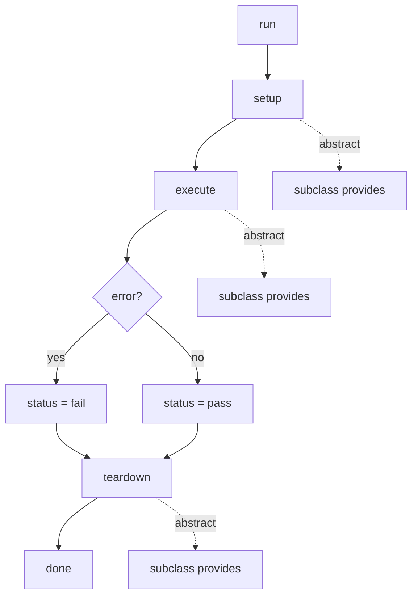

### 📊 Abstract vs interface — decision guide

| Question | Choose |
|---|---|
| Need shared code across subclasses? | Abstract class |
| Need multiple contracts? | Interfaces |
| Need runtime `instanceof`? | Class (abstract or concrete) |
| Only describing data shape? | Interface / type |
| Need constructors/injected deps? | Abstract class |
| Purely a capability (e.g. `Reportable`)? | Interface |

### 🎯 Interview questions

| Question | Answer |
|---|---|
| Can you instantiate an abstract class? | No — `TypeError`/compile error. |
| Can an abstract class have a constructor? | Yes — used by subclasses via `super()`. |
| Can it have concrete methods? | Yes — that's the main benefit. |
| Can an abstract method have a body? | No. |
| Can a subclass be abstract too? | Yes — it can defer some abstract members. |
| Abstract class with no abstract members? | Legal, but pointless — use a concrete class. |
| Multiple abstract classes? | No — single inheritance. |
| Abstract vs interface for POM? | Abstract `BaseTest`/`BasePage` for shared code; interface for contracts. |
| Can an abstract class implement an interface? | Yes, and it may leave members abstract. |
| What design pattern does this enable? | Template Method — fixed skeleton, variable steps. |
| Does the abstract keyword exist at runtime? | No — it's compile-time only; the class is a normal class in JS. |

### 💻 Coding problems

**P4.16** — Abstract `Report` with a fixed `generate()` template.

```ts
abstract class Report {
  abstract rows(): string[][];
  abstract title(): string;

  generate(): string {
    const header = this.rows()[0]?.map(h => h.toUpperCase()).join(" | ") ?? "";
    const body = this.rows().slice(1).map(r => r.join(" | ")).join("\n");
    return `${this.title()}\n${header}\n${"-".repeat(header.length)}\n${body}`;
  }
}

class TestReport extends Report {
  constructor(private results: { name: string; status: string }[]) { super(); }
  title() { return "TEST REPORT"; }
  rows() {
    return [["name", "status"], ...this.results.map(r => [r.name, r.status])];
  }
}

console.log(new TestReport([{ name: "login", status: "pass" }]).generate());
```

**P4.17** — Abstract `Shape` with shared `describe()`.

```ts
abstract class Shape {
  abstract area(): number;
  abstract name(): string;
  describe(): string {
    return `${this.name()}: area=${this.area().toFixed(2)}`;
  }
}
class Circle extends Shape {
  constructor(private r: number) { super(); }
  name() { return "circle"; }
  area() { return Math.PI * this.r ** 2; }
}
console.log(new Circle(2).describe()); // "circle: area=12.57"
```

⚡ **TL;DR (Part 4):** Classes are cookie cutters; `this` is the current cookie. Encapsulate with `#private`, inherit with `extends` + `super`, vary behaviour with overriding. TypeScript adds compile-time types, interfaces for contracts, enums for named constants, generics for reusable type-safe code, access modifiers for visibility, and abstract classes for shared skeletons with required steps.

---

# PART 5 — DIAGRAM LIBRARY

> All diagrams in one place for revision. Mermaid blocks render on GitHub, GitLab, and most Markdown viewers.

---

## 32. How JavaScript Runs (Source → Output)

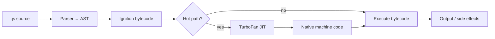

```
┌───────────┐   ┌───────────┐   ┌───────────┐   ┌───────────┐
│  source   │──▶│   parse   │──▶│ bytecode  │──▶│  machine  │──▶ output
│  .js/.ts  │   │   (AST)   │   │ (Ignition)│   │ (TurboFan)│
└───────────┘   └───────────┘   └───────────┘   └───────────┘
```

---

## 33. Event Loop

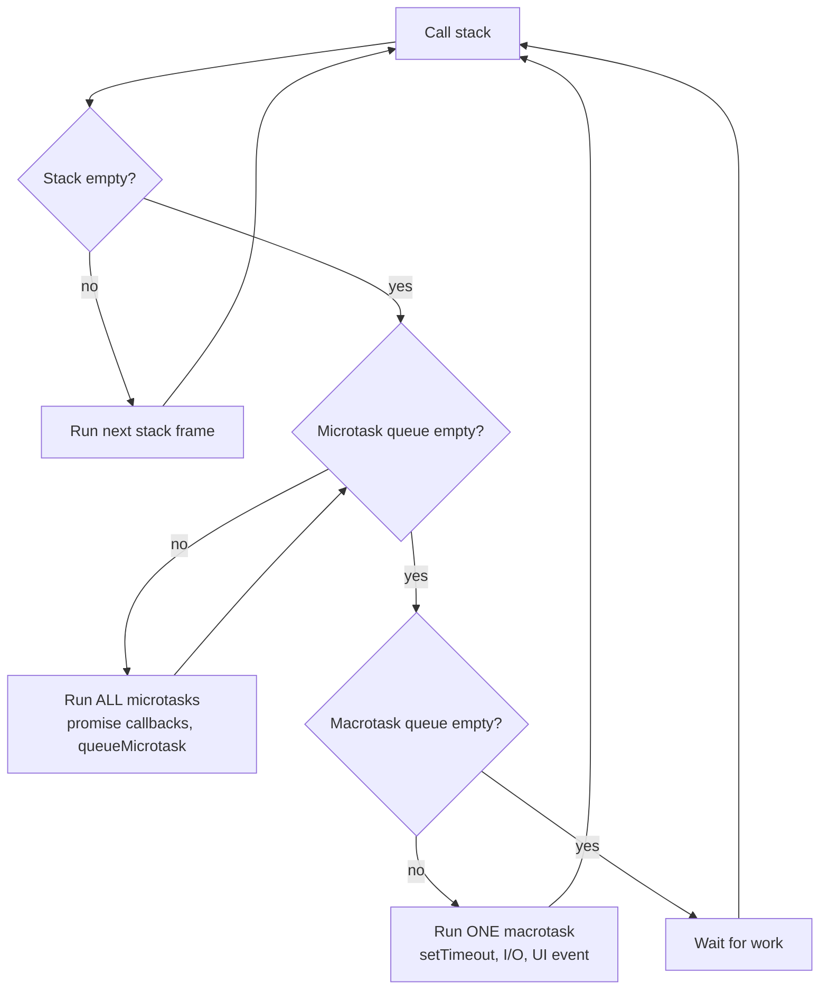

```
Priority order:
  synchronous code
      ↓
  microtasks  (Promise.then, await continuations, queueMicrotask)
      ↓
  macrotasks  (setTimeout, setInterval, I/O, events)
      ↓
  render (browsers only)
```

**Output prediction recipe:**

```js
console.log("1");
setTimeout(() => console.log("2"), 0);
Promise.resolve().then(() => console.log("3"));
console.log("4");
// 1, 4, 3, 2
```

---

## 34. Promise Lifecycle

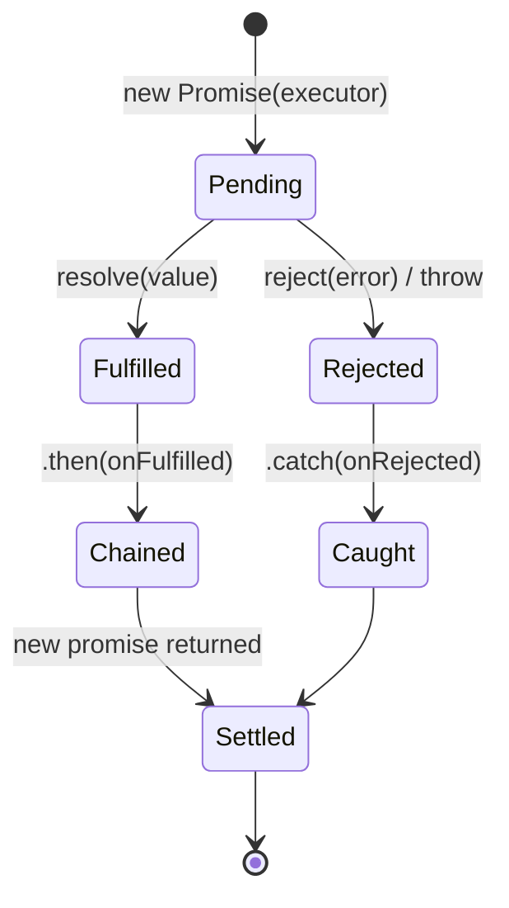

```
Promise.all:        all fulfil → [v1, v2]      any reject → reject(first)
Promise.allSettled: all settle → [{status,…}]  never rejects
Promise.race:       first settle → that result
Promise.any:        first fulfil → value       all reject → AggregateError
```

---

## 35. Async / Await Timeline

```
async function run() {
  log("A");                 ┐
  const x = await fetchX();  │ suspended here
  log("B", x);              ┘ resumes as microtask
  return "done";
}

Timeline:
  t0  run() called → logs "A" → fetch starts → returns pending promise
  t1  caller continues (other sync code runs)
  t2  fetchX settles → microtask queued
  t3  microtask runs → logs "B" → run()'s promise fulfils
```

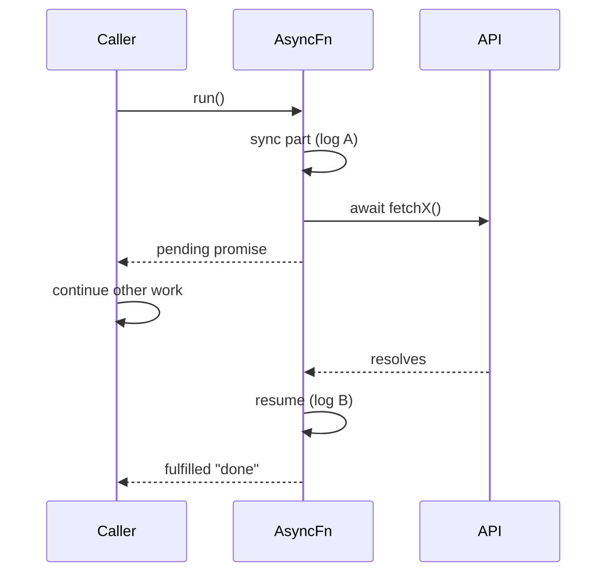

---

## 36. Scope Chain and Closures

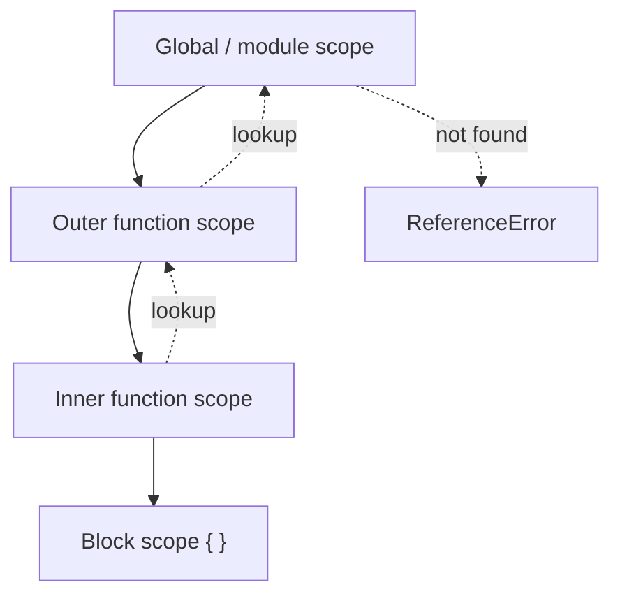

```
Closure = function + captured environment

function outer() {
  let n = 0;          ← captured
  return () => ++n;   ← closure
}
const inc = outer();  ← outer's scope would die…
inc();                ← …but the closure keeps `n` alive
```

---

## 37. Prototype Chain

```mermaid
flowchart BT
    A["dog instance<br/>{ name: 'Rex' }"] --> B["Dog.prototype<br/>bark()"]
    B --> C["Animal.prototype<br/>eat()"]
    C --> D["Object.prototype<br/>toString()"]
    D --> E["null"]
```

```
Lookup for dog.bark:
  dog (own props) → Dog.prototype ✅ found → stop
Lookup for dog.toString:
  dog → Dog.prototype → Animal.prototype → Object.prototype ✅
Lookup for dog.fly:
  dog → Dog.prototype → Animal.prototype → Object.prototype → null → undefined
```

---

## 38. OOP Relationships

```mermaid
classDiagram
    class BaseTest {
        <<abstract>>
        #testName
        +run()
        +setup()*
        +execute()*
        +teardown()*
    }
    class UITest {
        +setup()
        +execute()
        +teardown()
    }
    class APITest {
        +setup()
        +execute()
        +teardown()
    }
    class LoginPage {
        -locators
        +open()
    }
    BaseTest <|-- UITest
    BaseTest <|-- APITest
    UITest --> LoginPage : uses
```

| Relationship | Keyword | Meaning |
|---|---|---|
| is-a | `extends` / `implements` | Inheritance / contract |
| has-a | field | Composition |
| uses-a | parameter | Dependency |

---

## 39. TypeScript Type Decision Tree

```mermaid
flowchart TD
    A{What are you describing?} -->|Object shape| B{Need declaration merging or extends?}
    B -->|yes| C[interface]
    B -->|no| D[type]
    A -->|Union / intersection| D
    A -->|Tuple / primitive alias| D
    A -->|Named constants| E{Need runtime object?}
    E -->|yes| F[enum or as const object]
    E -->|no| G[union of literals]
    A -->|Reusable over types| H[generic]
    A -->|Shared implementation| I[abstract class]
    A -->|Capability only| C
```

---

## 40. Test Automation Flow (how the concepts combine)

```mermaid
flowchart TD
    A[Test file .spec.ts] --> B[Fixtures / setup]
    B --> C[Config from env]
    C --> D[Page Object]
    D --> E[Playwright API]
    E --> F[Browser]
    F --> G[Results]
    G --> H[Reporter interface]
    H --> I[Console / HTML / JSON]

    A -.uses.-> J[async/await]
    D -.uses.-> K[classes + encapsulation]
    H -.uses.-> L[interfaces + polymorphism]
    C -.uses.-> M[enums + generics]
```

```
Typical run:
  config (env) → fixture creates page → POM action → await assertion
      → result object → reporter → report file
```

---

# PART 6 — INTERVIEW QUESTION BANK

> 100 Q&A grouped by topic, plus a QA/Playwright lens. Answers are deliberately one-liners so you can scan before an interview.

---

## 41. JavaScript Core

| # | Question | Answer |
|---|---|---|
| 1 | What are the primitive types? | `string`, `number`, `boolean`, `bigint`, `symbol`, `undefined`, `null` (7). |
| 2 | What is the object type? | Everything non-primitive: objects, arrays, functions, dates, maps. |
| 3 | `undefined` vs `null`? | Not assigned vs intentionally empty. |
| 4 | `==` vs `===`? | Loose (coerces) vs strict (type + value). |
| 5 | Truthy vs falsy? | Falsy: `false, 0, -0, 0n, "", null, undefined, NaN`. |
| 6 | `var` vs `let` vs `const`? | Function scope / block scope / block scope + no reassignment. |
| 7 | What is hoisting? | Declarations registered before execution; not literal movement. |
| 8 | What is the TDZ? | The period where a `let`/`const` binding exists but can't be accessed. |
| 9 | `typeof null`? | `"object"` (legacy bug). |
| 10 | `typeof undefined`? | `"undefined"`. |
| 11 | How to check an array? | `Array.isArray(x)`. |
| 12 | How to check `NaN`? | `Number.isNaN(x)`. |
| 13 | Is JS statically or dynamically typed? | Dynamically typed (TS adds static types at compile time). |
| 14 | Is JS single-threaded? | Yes for execution; async work is delegated to the runtime/event loop. |
| 15 | What is the event loop? | The scheduler that drains the call stack, then microtasks, then macrotasks. |
| 16 | Microtask vs macrotask? | Microtasks (promises) run before the next macrotask (timers, I/O). |
| 17 | What is a closure? | A function plus the lexical environment it captured. |
| 18 | What is lexical scope? | Scope determined by where code is written. |
| 19 | What is a IIFE? | A function that runs immediately in its own private scope. |
| 20 | What is `this`? | The object bound at call time (or lexical for arrows). |
| 21 | `call` vs `apply` vs `bind`? | Invoke with args / invoke with array / return a bound copy. |
| 22 | Arrow vs normal function? | No own `this`/`arguments`, can't be `new`ed, implicit return. |
| 23 | What is a pure function? | Deterministic, no side effects. |
| 24 | What is currying? | Turning `f(a,b,c)` into `f(a)(b)(c)`. |
| 25 | What is memoisation? | Caching results by input inside a closure. |

---

## 42. Data Structures & Methods

| # | Question | Answer |
|---|---|---|
| 26 | `slice` vs `splice`? | Copy vs mutate. |
| 27 | `map` vs `forEach`? | New array vs `undefined`. |
| 28 | `filter` vs `find`? | All matches vs first match. |
| 29 | `some` vs `every`? | Any match vs all match. |
| 30 | What does `reduce` do? | Folds an array into a single value. |
| 31 | Why is `sort()` surprising? | It sorts lexicographically; pass a comparator for numbers. |
| 32 | How to remove duplicates? | `[...new Set(arr)]`. |
| 33 | How to copy an array deeply? | `structuredClone(arr)`. |
| 34 | Shallow copy an object? | `{ ...obj }` or `Object.assign({}, obj)`. |
| 35 | How to check an empty object? | `Object.keys(obj).length === 0`. |
| 36 | `for…of` vs `for…in`? | Values of iterables vs keys of objects. |
| 37 | String mutability? | Strings are immutable. |
| 38 | Reverse a string? | `[...s].reverse().join("")`. |
| 39 | `slice` vs `substring`? | `slice` supports negatives; `substring` clamps/swaps. |
| 40 | What is destructuring? | Unpacking values/properties into variables. |
| 41 | What is the spread operator for? | Expanding iterables into arrays/args/objects. |
| 42 | What is optional chaining? | `obj?.a?.b` — safe access on nullish values. |
| 43 | `??` vs `\|\|`? | Nullish-only fallback vs any falsy fallback. |

---

## 43. Functions, Async, Modules

| # | Question | Answer |
|---|---|---|
| 44 | What is a callback? | A function passed to be invoked later. |
| 45 | What is callback hell? | Deep nesting caused by chained callbacks. |
| 46 | What is a promise? | A placeholder for an eventual value/failure. |
| 47 | Promise states? | `pending`, `fulfilled`, `rejected`. |
| 48 | `Promise.all` vs `allSettled`? | Fail-fast vs wait-for-all. |
| 49 | `race` vs `any`? | First settled vs first fulfilled. |
| 50 | Can promises be cancelled? | Not natively; use `AbortController`. |
| 51 | What does `async` return? | A promise. |
| 52 | Does `await` block the thread? | No — it suspends the function only. |
| 53 | How to run async tasks in parallel? | `Promise.all([...])`. |
| 54 | Why doesn't `forEach` await? | It ignores returned promises; use `for…of` or `Promise.all(map)`. |
| 55 | What is an unhandled rejection? | A rejected promise with no handler. |
| 56 | ESM vs CommonJS? | Static/async imports vs dynamic/sync `require`. |
| 57 | Named vs default export? | Exact named bindings vs one arbitrary default. |
| 58 | What is tree-shaking? | Removing unused exports at build time. |
| 59 | What is a module namespace? | `import * as ns` — an object of all named exports. |
| 60 | How to lazy-load a module? | `await import("./m.js")`. |

---

## 44. OOP

| # | Question | Answer |
|---|---|---|
| 61 | What is a class? | A template for creating objects with shared behaviour. |
| 62 | What does `new` do? | Creates an object, links the prototype, runs the constructor. |
| 63 | What is a constructor? | The initialiser that runs on `new`. |
| 64 | Instance vs static member? | Per-object vs on the class itself. |
| 65 | What is encapsulation? | Hiding internals behind a public API. |
| 66 | How is encapsulation achieved? | `#private`, closures, TS modifiers. |
| 67 | What is inheritance? | A child class reusing a parent's members. |
| 68 | Does JS support multiple inheritance? | No — use interfaces/mixins. |
| 69 | Why `super()` first? | `this` isn't available until the parent constructor runs. |
| 70 | What is overriding? | Redefining an inherited method. |
| 71 | What is polymorphism? | One interface, multiple implementations. |
| 72 | Overloading vs overriding? | Same-class signatures vs subclass replacement. |
| 73 | What is duck typing? | Behaviour by shape, not declared type. |
| 74 | What is an abstract class? | A non-instantiable base with required members. |
| 75 | Abstract class vs interface? | Shared code + state vs pure contract. |
| 76 | What is the template method pattern? | A fixed algorithm with subclass-provided steps. |
| 77 | `prototype` vs `__proto__`? | Constructor property vs instance link. |
| 78 | What is `instanceof`? | Prototype-chain membership test. |
| 79 | What is composition over inheritance? | Prefer "has-a" to avoid tight coupling. |
| 80 | Why use POMs? | Encapsulate selectors/actions, reuse across tests. |

---

## 45. TypeScript

| # | Question | Answer |
|---|---|---|
| 81 | Does TS run in the browser? | No — it compiles to JS. |
| 82 | Do types exist at runtime? | No — erased. |
| 83 | `any` vs `unknown`? | Unchecked vs must-be-narrowed. |
| 84 | What is `never`? | A type for impossible values/exhaustive checks. |
| 85 | `interface` vs `type`? | Merging/extends vs unions/tuples/aliases. |
| 86 | What is type inference? | Compiler deduces types automatically. |
| 87 | What is type narrowing? | Refining a union via `typeof`/`instanceof`/`in`/discriminants. |
| 88 | What is a discriminated union? | Union members sharing a literal tag. |
| 89 | What does `strict` do? | Enables strict null checks, no implicit any, etc. |
| 90 | Is `as` a runtime cast? | No — a compile-time assertion. |
| 91 | What is `satisfies`? | Validates a type without widening the inferred type. |
| 92 | What is a generic? | A type parameter for reuse with safety. |
| 93 | What is `keyof`? | Union of an object's keys. |
| 94 | `Partial<T>` / `Pick<T,K>` / `Omit<T,K>`? | All optional / subset / remove keys. |
| 95 | What is an enum? | Named constants with a runtime object. |
| 96 | Numeric vs string enum? | Reverse mapping vs readable values (preferred). |
| 97 | `private` vs `#private`? | Compile-time only vs runtime-enforced. |
| 98 | What does `readonly` guarantee? | No reassignment (shallow, compile-time). |
| 99 | Can abstract methods have bodies? | No. |
| 100 | Can an abstract class implement an interface? | Yes, and may leave members abstract. |

---

## 46. QA / Playwright Lens

| Question | Answer |
|---|---|
| Why should QA learn closures? | Test state factories and avoiding shared-state bugs. |
| Why async/await in tests? | Every Playwright action returns a promise. |
| Why `Promise.all` in tests? | Parallel independent API checks. |
| Why avoid `waitForTimeout`? | Prefer auto-waiting assertions/locators — fixed sleeps are flaky. |
| Where do enums help? | Browser names, statuses, environments. |
| Where do interfaces help? | Page/API contracts, mock injection. |
| Where do generics help? | Typed API responses and repositories. |
| Where do abstract classes help? | Base test/page with shared lifecycle and required hooks. |
| Why use `readonly` for locators? | Prevent accidental reassignment. |
| Why encapsulate locators? | Tests express intent; selector changes stay in one file. |

---

# PART 7 — CODING PROBLEMS

> 27 problems with solutions, ordered by difficulty. Each is a classic interview or test-automation task.
> Try writing the solution first; the answer is directly under each problem.

---

## 47. Warm-up (Strings & Numbers)

### 💻 C1 — Reverse words in a sentence
Input: `"the quick brown fox"` → `"fox brown quick the"`.

```js
const reverseWords = s => s.trim().split(/\s+/).reverse().join(" ");
console.log(reverseWords("the quick brown fox")); // "fox brown quick the"
```

### 💻 C2 — Palindrome check (ignore case and punctuation)
`"A man, a plan, a canal: Panama"` → `true`.

```js
function isPalindrome(s) {
  const clean = s.toLowerCase().replace(/[^a-z0-9]/g, "");
  return clean === [...clean].reverse().join("");
}
```

### 💻 C3 — FizzBuzz with a twist
Print numbers 1–30; multiples of 3 → `Fizz`, 5 → `Buzz`, 7 → `Bazz`, combined otherwise.

```js
for (let i = 1; i <= 30; i++) {
  let out = "";
  if (i % 3 === 0) out += "Fizz";
  if (i % 5 === 0) out += "Buzz";
  if (i % 7 === 0) out += "Bazz";
  console.log(out || i);
}
```

### 💻 C4 — Character frequency
`"playwright"` → `{ p:1, l:1, a:1, y:1, w:1, r:1, i:1, g:1, h:1, t:1 }` (order irrelevant).

```js
const freq = s => [...s].reduce((m, c) => (m[c] = (m[c] || 0) + 1, m), {});
console.log(freq("playwright"));
```

### 💻 C5 — Title Case without regex

```js
const titleCase = s =>
  s.toLowerCase().split(" ").map(w => w ? w[0].toUpperCase() + w.slice(1) : "").join(" ");
console.log(titleCase("hello   world from qa")); // "Hello   World From Qa"
```

---

## 48. Arrays

### 💻 C6 — Two Sum (return indices)
`[2, 7, 11, 15], target 9` → `[0, 1]`.

```js
function twoSum(nums, target) {
  const seen = new Map();
  for (let i = 0; i < nums.length; i++) {
    const need = target - nums[i];
    if (seen.has(need)) return [seen.get(need), i];
    seen.set(nums[i], i);
  }
  return [];
}
```

### 💻 C7 — Move zeroes to the end (in place)
`[0,1,0,3,12]` → `[1,3,12,0,0]`.

```js
function moveZeroes(nums) {
  let write = 0;
  for (let i = 0; i < nums.length; i++) {
    if (nums[i] !== 0) nums[write++] = nums[i];
  }
  while (write < nums.length) nums[write++] = 0;
  return nums;
}
```

### 💻 C8 — Flatten arbitrarily nested arrays

```js
const flatten = arr => arr.reduce(
  (out, v) => out.concat(Array.isArray(v) ? flatten(v) : v), []
);
console.log(flatten([1, [2, [3, [4]], 5]])); // [1,2,3,4,5]
```

### 💻 C9 — Intersection of two arrays (unique)

```js
const intersection = (a, b) => [...new Set(a)].filter(x => new Set(b).has(x));
console.log(intersection([1, 2, 2, 3], [2, 3, 4])); // [2, 3]
```

### 💻 C10 — Longest consecutive sequence
`[100,4,200,1,3,2]` → `4` (`1,2,3,4`).

```js
function longestConsecutive(nums) {
  const set = new Set(nums);
  let best = 0;
  for (const n of set) {
    if (set.has(n - 1)) continue;   // only start at a sequence head
    let len = 1;
    while (set.has(n + len)) len++;
    best = Math.max(best, len);
  }
  return best;
}
```

### 💻 C11 — Chunk an array

```js
const chunk = (arr, size) =>
  Array.from({ length: Math.ceil(arr.length / size) }, (_, i) =>
    arr.slice(i * size, i * size + size));
console.log(chunk([1,2,3,4,5], 2)); // [[1,2],[3,4],[5]]
```

### 💻 C12 — Sort objects by a key, stable

```js
const byStatus = (a, b) => a.status.localeCompare(b.status);
const sorted = [{status:"fail",n:1},{status:"pass",n:2},{status:"fail",n:3}]
  .sort(byStatus);
console.log(sorted.map(x => x.n)); // stable: [1,3,2]
```

---

## 49. Objects & Data Shaping

### 💻 C13 — Deep equality

```js
function deepEqual(a, b) {
  if (a === b) return true;
  if (typeof a !== "object" || typeof b !== "object" || !a || !b) return false;
  const ka = Object.keys(a), kb = Object.keys(b);
  if (ka.length !== kb.length) return false;
  return ka.every(k => deepEqual(a[k], b[k]));
}
console.log(deepEqual({ a: { b: [1, 2] } }, { a: { b: [1, 2] } })); // true
```

### 💻 C14 — Invert an object (group keys by value)

```js
function invert(o) {
  return Object.entries(o).reduce((acc, [k, v]) => {
    (acc[v] ??= []).push(k);
    return acc;
  }, {});
}
console.log(invert({ a: 1, b: 2, c: 1 })); // { "1": ["a","c"], "2": ["b"] }
```

### 💻 C15 — Pick and omit (without lodash)

```js
const pick = (o, keys) => Object.fromEntries(keys.filter(k => k in o).map(k => [k, o[k]]));
const omit = (o, keys) => Object.fromEntries(Object.entries(o).filter(([k]) => !keys.includes(k)));

const u = { id: 1, name: "Shashi", role: "QA" };
console.log(pick(u, ["id", "role"]));  // { id: 1, role: "QA" }
console.log(omit(u, ["role"]));        // { id: 1, name: "Shashi" }
```

### 💻 C16 — Flatten an object to dot paths

```js
function flattenObject(obj, prefix = "") {
  return Object.entries(obj).reduce((acc, [k, v]) => {
    const key = prefix ? `${prefix}.${k}` : k;
    if (v && typeof v === "object" && !Array.isArray(v)) Object.assign(acc, flattenObject(v, key));
    else acc[key] = v;
    return acc;
  }, {});
}
console.log(flattenObject({ a: { b: 1 }, c: 2 })); // { "a.b": 1, c: 2 }
```

---

## 50. Logic & Algorithms

### 💻 C17 — Run-length encoding
`"aaabbc"` → `"a3b2c1"`.

```js
function rle(s) {
  let out = "", i = 0;
  while (i < s.length) {
    let j = i;
    while (j < s.length && s[j] === s[i]) j++;
    out += s[i] + (j - i);
    i = j;
  }
  return out;
}
```

### 💻 C18 — Balanced brackets

```js
function isBalanced(s) {
  const pairs = { ")": "(", "]": "[", "}": "{" };
  const stack = [];
  for (const c of s) {
    if ("([{".includes(c)) stack.push(c);
    else if (pairs[c]) {
      if (stack.pop() !== pairs[c]) return false;
    }
  }
  return stack.length === 0;
}
console.log(isBalanced("{[()]}")); // true
console.log(isBalanced("([)]"));   // false
```

### 💻 C19 — Fibonacci: memoised vs iterative

```js
// memoised recursion — O(n)
function fib(n, memo = new Map()) {
  if (n <= 1) return n;
  if (memo.has(n)) return memo.get(n);
  const value = fib(n - 1, memo) + fib(n - 2, memo);
  memo.set(n, value);
  return value;
}

// iterative — O(1) space
function fibIter(n) {
  let a = 0, b = 1;
  for (let i = 0; i < n; i++) [a, b] = [b, a + b];
  return a;
}
console.log(fib(30), fibIter(30)); // 832040 832040
```

### 💻 C20 — Group and summarise test results

```js
function summarise(results) {
  return results.reduce((acc, { status, duration }) => {
    acc[status] = (acc[status] || 0) + 1;
    acc.totalDuration += duration;
    return acc;
  }, { totalDuration: 0 });
}
console.log(summarise([
  { status: "pass", duration: 120 },
  { status: "fail", duration: 80 },
  { status: "pass", duration: 100 },
]));
// { pass: 2, fail: 1, totalDuration: 300 }
```

---

## 51. Async Problems

### 💻 C21 — Sequential vs parallel timing

```js
const delay = (ms, v) => new Promise(r => setTimeout(() => r(v), ms));

console.time("seq");
await delay(100, 1); await delay(100, 2); await delay(100, 3);
console.timeEnd("seq"); // ~300ms

console.time("par");
await Promise.all([delay(100, 1), delay(100, 2), delay(100, 3)]);
console.timeEnd("par"); // ~100ms
```

### 💻 C22 — Retry with exponential backoff

```js
async function retry(fn, { attempts = 3, base = 200 } = {}) {
  let lastError;
  for (let i = 0; i < attempts; i++) {
    try {
      return await fn();
    } catch (err) {
      lastError = err;
      await new Promise(r => setTimeout(r, base * 2 ** i));
    }
  }
  throw lastError;
}
```

### 💻 C23 — Promise-based task queue (concurrency limit)

```js
function createQueue(limit) {
  const queue = [];
  let active = 0;

  const next = () => {
    if (active >= limit || queue.length === 0) return;
    const { task, resolve, reject } = queue.shift();
    active++;
    task().then(resolve, reject).finally(() => {
      active--;
      next();
    });
  };

  return task => new Promise((resolve, reject) => {
    queue.push({ task, resolve, reject });
    next();
  });
}

const run = createQueue(2);
await Promise.all([run(() => delay(100, "a")), run(() => delay(100, "b")), run(() => delay(100, "c"))]);
```

---

## 52. OOP / TypeScript Problems

### 💻 C24 — Page Object Model with a base page (TS)

```ts
interface Page { readonly url: string; open(): Promise<void>; isLoaded(): Promise<boolean>; }

abstract class BasePage implements Page {
  abstract readonly url: string;
  constructor(protected readonly page: any) {}
  async open(): Promise<void> { await this.page.goto(this.url); }
  abstract isLoaded(): Promise<boolean>;
  protected async text(selector: string): Promise<string> {
    return this.page.textContent(selector);
  }
}

class LoginPage extends BasePage {
  readonly url = "/login";
  async isLoaded() { return this.page.isVisible("#login-form"); }
  async login(user: string, pass: string) {
    await this.page.fill("#user", user);
    await this.page.fill("#pass", pass);
    await this.page.click("#submit");
  }
}
```

### 💻 C25 — Generic API client with typed responses (TS)

```ts
interface ApiResponse<T> { status: number; data: T; }

async function getJson<T>(url: string): Promise<ApiResponse<T>> {
  const res = await fetch(url);
  if (!res.ok) throw new Error(`HTTP ${res.status}`);
  return { status: res.status, data: (await res.json()) as T };
}

interface User { id: string; name: string }

const { data: users } = await getJson<User[]>("/api/users");
console.log(users.map(u => u.name));
```

### 💻 C26 — Strategy pattern for browser launch (TS enum + interface)

```ts
enum Browser { Chromium = "chromium", Firefox = "firefox", WebKit = "webkit" }

interface Launcher { launch(): Promise<void>; }

class PlaywrightLauncher implements Launcher {
  constructor(private browser: Browser) {}
  async launch() { console.log(`launch ${this.browser}`); }
}

const launchers: Record<Browser, () => Launcher> = {
  [Browser.Chromium]: () => new PlaywrightLauncher(Browser.Chromium),
  [Browser.Firefox]: () => new PlaywrightLauncher(Browser.Firefox),
  [Browser.WebKit]: () => new PlaywrightLauncher(Browser.WebKit),
};

await launchers[Browser.Firefox]().launch();
```

### 💻 C27 — Inventory with encapsulation, inheritance, polymorphism

```ts
abstract class Item {
  protected constructor(public readonly name: string, protected price: number) {}
  abstract finalPrice(): number;
  describe(): string { return `${this.name}: ₹${this.finalPrice().toFixed(2)}`; }
}

class Book extends Item {
  constructor(name: string, price: number, private taxRate = 0.05) { super(name, price); }
  finalPrice() { return this.price * (1 + this.taxRate); }
}

class Electronics extends Item {
  constructor(name: string, price: number, private warranty = 0.1) { super(name, price); }
  finalPrice() { return this.price * (1 + this.warranty); }
}

const cart: Item[] = [new Book("JS Guide", 500), new Electronics("Mouse", 1000)];
cart.forEach(i => console.log(i.describe()));
// JS Guide: ₹525.00
// Mouse: ₹1100.00
```

---

# PART 8 — CHEAT SHEETS

---

## 53. One-Page JavaScript Cheat Sheet

| Topic | Remember |
|---|---|
| Declarations | `const` default, `let` if reassigned, never `var` |
| Equality | `===` always; `x == null` for null-or-undefined |
| Falsy | `false, 0, -0, 0n, "", null, undefined, NaN` |
| Fallback | `??` for nullish, `\|\|` for any falsy |
| Safe access | `obj?.a?.b`, `fn?.()` |
| Copy array | `[...arr]`, `arr.slice()` |
| Copy object | `{ ...obj }` (shallow), `structuredClone(obj)` (deep) |
| Loop array | `for…of` or `forEach` |
| Loop object | `Object.entries` + `for…of` |
| Find | `find`, `findIndex`, `some`, `every` |
| Transform | `map`, `filter`, `reduce`, `flatMap` |
| Sort numbers | `arr.sort((a,b) => a-b)` |
| Dedupe | `[...new Set(arr)]` |
| String → array | `[...s]`, `s.split("")` |
| Number → string | `String(n)`, `` `${n}` `` |
| Check types | `Array.isArray`, `Number.isNaN`, `typeof`, `instanceof` |
| Async | `async/await` + `try/catch`, `Promise.all` for parallel |
| Errors | `throw new Error(msg)`, custom `class X extends Error` |

---

## 54. Array Method Cheat Sheet

| Method | Returns | Mutates | Callback args |
|---|---|---|---|
| `forEach` | `undefined` | ❌ | `(value, index, array)` |
| `map` | new array | ❌ | `(value, index, array)` |
| `filter` | new array | ❌ | `(value, index, array)` |
| `find` | element | ❌ | `(value, index, array)` |
| `findIndex` | index | ❌ | `(value, index, array)` |
| `some` | boolean | ❌ | `(value, index, array)` |
| `every` | boolean | ❌ | `(value, index, array)` |
| `reduce` | accumulator | ❌ | `(acc, value, index, array)` |
| `sort` | same array | ✅ | `(a, b)` |
| `reverse` | same array | ✅ | — |
| `splice` | removed items | ✅ | — |
| `slice` | new array | ❌ | — |
| `concat` | new array | ❌ | — |
| `flat` | new array | ❌ | — |
| `join` | string | ❌ | — |

---

## 55. TypeScript Cheat Sheet

| Need | Write |
|---|---|
| Object contract | `interface User { id: string; name?: string }` |
| Union | `type Status = "pass" \| "fail"` |
| Tuple | `type Pair = [string, number]` |
| Alias | `type ID = string \| number` |
| Generic fn | `function id<T>(x: T): T` |
| Constrained generic | `<T extends { id: string }>` |
| Key-safe access | `<K extends keyof T>` |
| Optional | `name?: string` |
| Readonly | `readonly id: string` |
| Index signature | `{ [key: string]: number }` |
| Partial / Required | `Partial<T>`, `Required<T>` |
| Pick / Omit | `Pick<T, "a">`, `Omit<T, "b">` |
| Record | `Record<Browser, Config>` |
| Return type | `ReturnType<typeof fn>` |
| Promise result | `Awaited<Promise<T>>` |
| Assertion | `value as T` (no runtime effect) |
| Narrowing | `typeof`, `instanceof`, `in`, tag checks |
| Exhaustive check | `const _: never = value` |
| Validate literal | `const c = {...} satisfies Config` |

---

## 56. OOP / TS Modifier Cheat Sheet

| Keyword | Class | Subclass | Outside | Runtime |
|---|---|---|---|---|
| `public` | ✅ | ✅ | ✅ | — |
| `protected` | ✅ | ✅ | ❌ | ❌ |
| `private` | ✅ | ❌ | ❌ | ❌ |
| `#field` | ✅ | ❌ | ❌ | ✅ |
| `readonly` | read | read | read | ❌ |
| `static` | via class | inherited | via class | ✅ |
| `abstract` | — | must implement | — | ❌ |
| `implements` | contract | — | — | ❌ |
| `extends` | inherit | — | — | ✅ |

---

## 57. Async Cheat Sheet

| Need | Code |
|---|---|
| Wait for one | `const v = await p;` |
| Wait for all | `await Promise.all([p1, p2]);` |
| All results, no throw | `await Promise.allSettled([...]);` |
| First to settle | `await Promise.race([...]);` |
| First success | `await Promise.any([...]);` |
| Sleep | `await new Promise(r => setTimeout(r, ms));` |
| Retry | loop + `try/catch` + `await sleep` |
| Timeout | `Promise.race([task, timeout])` |
| Convert callback | `promisify(fn)` / `new Promise` wrapper |
| Parallel map | `await Promise.all(items.map(fn))` |
| Sequential loop | `for (const x of items) await fn(x);` |
| Cancel | `AbortController` |

---

## 58. Diagram Cheat Sheet

| Concept | Diagram shape |
|---|---|
| Hoisting / TDZ | Two-phase timeline: memory creation → execution |
| Event loop | Stack → microtasks → macrotasks loop |
| Promise | State machine: pending → fulfilled/rejected |
| Async/await | Sequence diagram with suspension/resumption |
| Scope | Nested boxes; lookup arrows outward |
| Closure | Function box holding a captured environment |
| Prototype chain | Linked list instance → prototypes → null |
| OOP | Class diagram with inheritance arrows |
| Type choice | Decision tree |
| Test run | Pipeline: config → POM → API → reporter |

---

# PART 9 — MASTER TL;DR

| Area | The one thing to remember |
|---|---|
| **Program** | Source → parse → bytecode → JIT → output. |
| **Variables** | `const` default; TDZ makes `let`/`const` unusable before declaration. |
| **Types** | 7 primitives + object; `typeof null === "object"`. |
| **Operators** | Use `===`; `??` only falls back on nullish; 8 falsy values. |
| **Control flow** | `if/else` for ranges, `switch` for exact values with `break`. |
| **Loops** | `for…of` = values, `for…in` = keys; `forEach` can't break. |
| **Arrays** | `slice` copies, `splice` mutates, `sort` compares strings by default. |
| **Strings** | Immutable; `slice`/`split`/`replace` return new strings. |
| **Objects** | Reference types; spread is shallow; `structuredClone` is deep. |
| **Functions** | First-class; arrows bind `this` lexically; closures capture scope. |
| **Hoisting** | Declarations registered early; function declarations are fully usable. |
| **Callbacks** | Pass a function to run later; nesting causes callback hell. |
| **Promises** | `all` fail-fast, `allSettled` full report, `race` first, `any` first success. |
| **async/await** | Looks sync, doesn't block; use `Promise.all` for parallelism. |
| **Modules** | ESM = static + async + tree-shakeable; CJS = dynamic + sync. |
| **Classes** | Cookie cutter; `this` = call-site object; `#` is real privacy. |
| **Encapsulation** | Hide data, expose intent; validate at the public boundary. |
| **Inheritance** | `extends` + `super`; prefer composition when "is-a" isn't true. |
| **Polymorphism** | One call, many behaviours: overriding, duck typing, generics. |
| **TypeScript** | Compile-time only; `unknown` > `any`; interfaces for contracts. |
| **Enums** | Named constants with a runtime object; prefer string enums. |
| **Generics** | Type parameters preserve relationships; constrain with `extends`. |
| **Modifiers** | `public`/`protected`/`private` are compile-time; `#` is runtime. |
| **Abstract classes** | Shared skeleton + required steps = Template Method. |

> **Study order for interviews:** Part 1 → Part 3 → Part 4 → Part 6 (Q&A) → Part 7 (solve problems) → Part 5 (whiteboard the diagrams from memory).

---

*Companion notes:* [`01_Identifier_Rules.md`](./01_Identifier_Rules.md) · [`02_Keyword_Notes.md`](./02_Keyword_Notes.md) · [`Source_Code_ByteCODE_Binary_IQ.md`](./Source_Code_ByteCODE_Binary_IQ.md) · [`../11_chapter_Funtions/102_Hoisting_TDZ.md`](../11_chapter_Funtions/102_Hoisting_TDZ.md) · [`../13_String/String_Cheatsheet.md`](../13_String/String_Cheatsheet.md)

